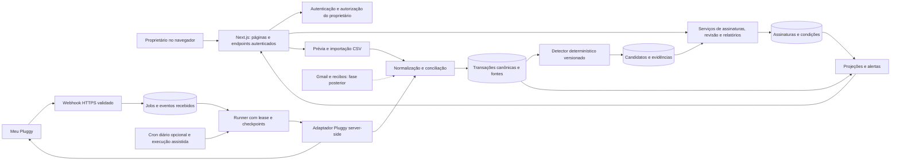
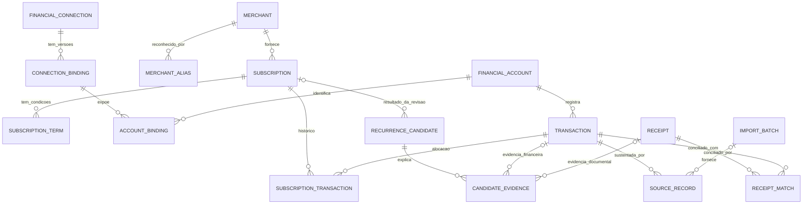
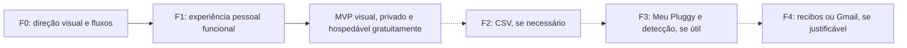

# Subscription Tracker — plano de produto e engenharia

Data da investigação: **28/10/2026**, America/Sao_Paulo. Status: **investigação histórica e plano de referência; implementação posteriormente autorizada pelo pedido “Implementa tudo”**.

> A aplicação pessoal foi implementada após esta investigação. Consulte o [README](../README.md) para execução, funcionalidades entregues, configuração de integrações e limitações atuais. Este documento preserva a pesquisa e as alternativas consideradas; itens futuros aqui descritos não significam funcionalidades já disponíveis.

Este documento entrega A–H: investigação, especificação, pesquisa de integrações, arquitetura, UX/UI, roadmap, decisões e questões abertas. Nenhuma integração foi autenticada, nenhuma conta foi criada e nenhum dado financeiro real foi consultado. Somente documentos foram produzidos.

## 0. Recomendação e leitura do plano

**Revisão de escopo após esclarecimento do proprietário:** aplicativo exclusivamente pessoal, hospedagem gratuita e **design excepcional como prioridade principal**. Não há objetivo de vender ou preparar um SaaS. Esta orientação substitui a recomendação anterior de MVP bancário e hospedagem paga.

Recomendo começar com uma **primeira versão visualmente completa e funcional**: dashboard, assinaturas com logos, cadastro/edição rápidos, ciclos mensal/anual, BRL/USD, próximas cobranças, pesquisa/filtros e exportação. CSV entra na etapa seguinte; detecção e Meu Pluggy continuam desejáveis, mas não condicionam o lançamento. Gmail/IA ficam como possibilidades sem compromisso de execução.

Arquitetura proposta: um projeto TypeScript/Next.js, banco PostgreSQL no Neon Free, Drizzle e Better Auth para um único proprietário. Hospedagem **Vercel Hobby + Neon Free**, com meta de **R$ 0 recorrente dentro das franquias**. Usar subdomínio gratuito, sem Railway, worker permanente, domínio pago, e-mail transacional ou modelo de IA obrigatório. Referências e limites em D.8.

Prioridades, nesta ordem: **1. design e interação; 2. visualizar e organizar assinaturas com facilidade; 3. correção dos valores e privacidade; 4. automação proporcional à necessidade**. O produto deve ser agradável de usar desde a primeira entrega, sem exigir a construção prévia de um sistema de conciliação bancária.

A pesquisa de integrações e o detector detalhado permanecem como material de referência para etapas opcionais. Não transformar esse material em lista obrigatória de implementação. D.4 separa o modelo inicial do futuro; F define a nova ordem executável.

### Convenção de evidência

- **Fato verificado:** observação local ou afirmação em fonte oficial consultada, com caminho/link.
- **Decisão proposta:** escolha de engenharia/produto deste plano; não representa código existente nem autorização de contratação.
- **Hipótese:** valor inicial a validar, incluindo pesos do detector, orçamento, escala e esforço.
- **Não verificado:** depende de conta real, contrato, instituição ou documentação que não publicou o detalhe.

As fontes são primárias. Números comerciais e permissões devem ser revalidados antes de implementar cada conector. Esta pesquisa não substitui uma prova com os bancos do proprietário.

## A. Codebase Investigation

### A.1. Método, escopo e resultado

**ORIENT / working, metodologia equivalente.** A skill `investigate-codebase` não consta do catálogo e não foi encontrada na busca por nome/`SKILL.md` em `/Users/cauaeyer/.agents`, `/Users/cauaeyer/.codex/skills` e `/Users/cauaeyer/.codex/plugins/cache`. Não foi instalada. Portanto, não é possível afirmar que seu `SKILL.md` foi lido ou seu protocolo exato executado.

Investigação realizada antes da criação dos documentos:

| Verificação | Evidência em 28/10/2026 | Conclusão |
| --- | --- | --- |
| Diretório atual | `pwd` → `/Users/cauaeyer/code/saastemics` | Escopo local correto |
| Conteúdo, inclusive ocultos | `ls -la` → apenas `.` e `..`, `total 0` | Pasta vazia |
| Instruções locais/ancestrais | Nenhum `AGENTS.md` na pasta, `/`, `/Users`, `/Users/cauaeyer` ou `/Users/cauaeyer/code` | Nenhuma convenção local adicional encontrada |
| Manifestos/configuração | `rg --files` com padrões para `package.json`, locks, README, configurações e `.env*` não retornou arquivos | Sem stack, scripts, dependências ou credenciais locais a preservar |
| Versionamento | `git rev-parse --show-toplevel` → erro “not a git repository” | Nem `.git` existente |
| Contexto de design | `impeccable context` reportou `NO_PRODUCT_MD`, `hasVisualImplementation: false` | Sem produto documentado ou autoridade visual preexistente |

**Fatos:** nenhum frontend, backend, componente, integração, migração, fluxo de autenticação ou persistência foi encontrado. Não existem arquivos de produção que possam ser citados como reaproveitáveis. `TRACE` não se aplica: não há fluxo para rastrear. Os caminhos de implementação abaixo são **previstos**, nunca achados do repositório.

**Inferência:** projeto greenfield. A escolha da stack é uma recomendação nova, feita somente após essa constatação. **Desconhecidos:** preferências técnicas não declaradas, infraestrutura já contratada fora desta pasta e bancos efetivamente utilizados.

### A.2. Skills e contexto durável

Foi lido integralmente o [SKILL.md de impeccable](/Users/cauaeyer/.agents/skills/impeccable/SKILL.md), além de `reference/shape.md`, `reference/operate.md` e `reference/init.md`; foi consultado `reference/new-work.md` para limites entre concepção e implementação. O launcher já disponível executou `context` uma vez, sem instalação. A versão usada foi 4.3.1; o launcher anunciou 4.8.0, mas nenhuma atualização foi executada.

Aplicação de **shape / Operate**: público, tarefa, prova, fluxos, hierarquia, estados e limites definidos em E. O brief do usuário resolve a descoberta principal. Sua instrução de não interromper por questões não bloqueantes prevalece sobre entrevistas opcionais da skill; hipóteses e direção visual permanecem propostas. Não foram criados telas, imagens, contrato visual, `DESIGN.md` definitivo ou configurações de preferência visual. O plano é o material para a revisão posterior.

Também foi lida a skill [supabase-postgres-best-practices](/Users/cauaeyer/.agents/skills/supabase-postgres-best-practices/SKILL.md), aplicável a PostgreSQL em geral, com referências de tipos, chaves, índices de FKs, privilégios, pooling e `SKIP LOCKED`. Isso não implica escolha de Supabase.

Artefatos desta etapa: [PRODUCT.md](../PRODUCT.md), com contexto derivado do brief e propostas identificadas, e este plano. `DESIGN.md` deverá registrar o sistema visual aprovado e validado na implementação; sua estrutura está em E.8.

## B. Product Specification

### B.1. Problema, usuário e resultado

**Visão:** facilitar a consulta e organização das próprias assinaturas em uma ferramenta visualmente marcante, rápida e agradável. Design é o principal investimento da primeira entrega; números corretos e privacidade são requisitos fundamentais. Automação reduz manutenção em uma evolução posterior, sem bloquear o valor inicial.

**Persona primária:** o proprietário, usuário de ferramentas de desenvolvimento, IA e infraestrutura, com cobranças em BRL/USD distribuídas por cartões e contas. Revisa custos por alguns minutos por semana e antes de renovações relevantes. Esse cenário de frequência é uma hipótese de UX, não uma entrevista realizada.

**Jobs principais:** identificar “o que continuo pagando”; explicar “por que meu custo mudou”; antecipar “o que será cobrado”; revisar “isso continua fazendo sentido?”. “Possivelmente esquecida” significa assinatura sem revisão recente ou pouco reconhecida, e não ausência comprovada de uso.

### B.2. Jornadas e limites de automação

1. Entrar, escolher moeda-base e adicionar primeira fonte: cadastro, arquivo ou conexão pessoal.
2. Conferir contas e intervalo disponível; importar/sincronizar sem duplicar movimentos existentes.
3. Revisar candidatos com comerciantes, datas, valores, periodicidade e justificativa.
4. Confirmar, ajustar, vincular a assinatura existente, rejeitar ou adiar por falta de evidência.
5. Consultar custo equivalente, gasto registrado, próximos eventos e alertas; abrir um número para ver sua origem.
6. Corrigir um vínculo ou cancelamento sem apagar o histórico financeiro; desconectar ou excluir dados conscientemente.

| Capacidade | Automação possível | Intervenção/limite |
| --- | --- | --- |
| Ler movimentos de fontes conectadas | Alta, após consentimento | Só contas autorizadas e suportadas; atraso/indisponibilidade são possíveis |
| Inferir periodicidade | Determinística com evidências | Poucos eventos, anuais e parcelamentos podem ser ambíguos |
| Identificar serviço por descrição | Parcial, via aliases | Intermediadores e descrições genéricas exigem revisão |
| Ler plano, trial ou renovação | Via recibos/templates futuros | E-mail pode estar ausente, equivocado ou ser promocional |
| Saber se o serviço está sendo usado | Geralmente inacessível | Só declaração do usuário ou API específica autorizada |
| Saber o próximo débito exato | Possível quando informado | Caso contrário, previsão com intervalo e proveniência |
| Cancelar contratos | Fora do escopo | Marcar cancelamento local não cancela no fornecedor |
| Encontrar tudo | Não garantido | Contas não conectadas, dinheiro, bundles e histórico incompleto ficam de fora |

### B.3. Requisitos funcionais priorizados

| ID | Prioridade/entrega | Requisito e regra verificável |
| --- | --- | --- |
| RF01 | P0 / Inicial | Criar, editar e arquivar/cancelar assinatura; serviço, valor, moeda, ciclo mensal/anual e próxima data; manter alterações com vigência |
| RF02 | P0 / Inicial | Dashboard com custo mensal equivalente, anual equivalente e próximas cobranças, cada número com significado explícito |
| RF03 | P0 / Inicial | Lista/detalhe com logos legítimos ou fallback, pesquisa, categoria, filtros e ordenação |
| RF04 | P0 / Inicial | BRL/USD, valores originais preservados e câmbio manual com data; sem taxa, exibir subtotais por moeda |
| RF05 | P0 / Inicial | Interface visualmente completa em desktop/mobile, teclado, vazios/erros/loading e feedback de salvar/desfazer |
| RF06 | P0 / Inicial | Login exclusivo do proprietário, persistência privada, exportação e exclusão dos dados próprios |
| RF07 | P1 / CSV | Importar arquivo com prévia/mapping; histórico de movimentos com dedup e sem dupla contagem de fatura |
| RF08 | P1 / Automação | Detectar candidatos de forma determinística; explicar e permitir confirmar/corrigir/rejeitar |
| RF09 | P1 / Automação | Meu Pluggy pessoal e sync limitado aos serviços gratuitos, com renovação de consentimento e falhas explícitas |
| RF10 | P1 / Automação | Alertas in-app de renovação/variação e saúde da conexão; sem entrega externa obrigatória |
| RF11 | Opcional | OFX e recibos importados, somente se resolverem uma necessidade concreta |
| RF12 | Opcional | Gmail opt-in, depois de medir benefício e aceitar a permissão necessária |
| RF13 | Fora do plano inicial | IA, APIs de uso específicas e notificações externas; não criar infraestrutura para elas antecipadamente |

Categorias iniciais editáveis: Desenvolvimento, IA, Infraestrutura, Produtividade, Conteúdo, Outros. Produto e categoria são conceitos separados. Não fabricar histórico de pagamentos a partir de assinaturas cadastradas: inicialmente, gráficos mostram condições conhecidas e projeções; gasto registrado exige movimentos reais importados ou informados.

### B.4. Requisitos não funcionais e critérios de sucesso

**Metas de engenharia, a testar; não resultados obtidos:**

- Integridade: importar/sincronizar a mesma entrada três vezes mantém a mesma despesa canônica; duas compras legítimas idênticas continuam possíveis.
- Rastreabilidade: todo total oferece critério, intervalo, moeda, FX e vínculos até evidências; overrides manuais nunca são sobrescritos silenciosamente.
- Segurança: todo acesso financeiro no servidor exige sessão do proprietário; nenhuma credencial bancária chega ao aplicativo.
- Privacidade: sem telemetria de conteúdo financeiro, caixa postal copiada integralmente ou envio a IA no MVP.
- Performance inicial: com até 100 assinaturas sintéticas, navegação e filtros responsivos; dashboard p95 < 2 s após aquecimento, medindo cold start separadamente. Massa de transações só é critério na fase de importação.
- Sync posterior: atualização sob demanda e, se habilitado, processamento diário nos limites do cron gratuito. Sem promessa de atualização em duas horas ou de tempo real; mostrar última consulta e dados pendentes.
- UX: WCAG 2.2 AA como alvo, teclado completo, 200% de zoom, 360–430 px mobile e 1280–1600 px desktop sem perda de ações essenciais.
- Recuperação inicial: exportação completa e importação/restauração validada, com lembrete semanal de cópia local e antes de exclusão/importação em lote. Backup automático diário é opcional; não impor RPO de 24 h ou novo serviço pago ao MVP.

**Validação da primeira entrega:** abrir o aplicativo e localizar custo mensal/próxima cobrança em poucos segundos; cadastrar ou editar uma assinatura sem atrito; layout revisado em desktop/mobile; nenhuma tela com aparência de placeholder, overflow ou dados inventados. Qualidade visual é critério de conclusão, não polimento facultativo. Exportar e restaurar os dados em ambiente isolado deve funcionar.

**Validação adicional somente quando habilitar automação:**

1. Inventariar manualmente fontes e assinaturas conhecidas para formar baseline; não confundir universo conhecido com cobertura total.
2. Alcançar precisão ≥ 90% entre candidatos de confiança alta em conjunto rotulado; se houver menos de 20 casos reais, publicar contagens e resultado como preliminar. Nunca apresentar score como probabilidade estatística calibrada.
3. Medir recall sobre assinaturas conhecidas que têm evidência suficiente na janela; anuais sem histórico e fontes ausentes aparecem à parte. Não fixar promessa de recall antes do piloto.
4. Revisar candidato típico em até 30 s e gastar no máximo 10 min/semana na manutenção após o onboarding — hipóteses a validar pelo proprietário.
5. Conciliar amostra de cobranças e um fechamento mensal sem diferença inexplicada; qualquer lacuna permanece visível.

## C. Integration Research

Pesquisa preservada como referência. Condições comerciais e alternativas foram verificadas por completude do pedido inicial, mas **não constituem objetivo, orçamento ou trabalho futuro obrigatório**. A primeira versão pessoal e visual não depende dessas integrações.

### C.1. Open Finance e Meu Pluggy: fatos atuais

Open Finance compartilha dados mediante consentimento; acesso direto ao ecossistema regulado não equivale a uma API pública pessoal. A rota proporcional aqui é um intermediário. A participação institucional e a revogação são descritas pelo [Banco Central](https://www.bcb.gov.br/meubc/faqs/s/open-finance).

**Resumo verificado do caminho pessoal:** gratuito, sem due diligence empresarial, até cinco conexões e sem uso comercial. Bancos são conectados primeiro no Meu Pluggy; depois o conector **MeuPluggy** no Dashboard expõe os itens. Guardar seus IDs: `GET /v2/items` não está disponível. O proxy atualiza a cada 24 h, não permite refresh manual e emite webhooks. Sua autorização ao aplicativo dura um ano, separada do consentimento bancário; renovar exige interação e pode mudar o item. `consentExpiresAt` vencido pode produzir listas vazias antes do erro `USER_AUTHORIZATION_EXPIRED`. Fonte: [guia oficial de uso pessoal](https://docs.pluggy.ai/pt/docs/guides/meu-pluggy-personal-use).

O [API Guide do Meu Pluggy](https://meu.pluggy.ai/api-guide) confirma acesso pessoal sem vencimento do trial, autenticação com Client ID/Secret trocados por API key, consultas de contas/transações e webhooks. Anuncia mais de 50 instituições, incluindo Nubank, Itaú, Bradesco, BB, Inter, XP e BTG. `nextAutoSyncAt: null` no proxy não significa falha. Não interpretar a descrição comercial de identidade/investimentos nesse guia como garantia de entitlement do plano: há divergência com a página de preços; o produto proposto só depende de contas, cartões e transações.

| Aspecto | Evidência e consequência |
| --- | --- |
| Limite de requisições pessoais | Não foi encontrada cota mensal/diária pública específica. **Não verificado; gratuito não significa ilimitado.** Validar no painel/termos antes do piloto |
| Rate limit geral | Tabela oficial lista 360/min/IP para `/auth`, contas e transações legadas; `PATCH /items` 20/min/IP. Isso é limite técnico, não franquia. A tabela não explicita separadamente `/v2/transactions`; respeitar headers e 429. [Rate limits](https://docs.pluggy.ai/pt/docs/developer-tools/rate-limits) |
| Instituições e cartões | Cobertura muda por instituição, contexto e consentimento. A tabela Open Finance inclui contas, transações e cartões em bancos como BB, Bradesco, Itaú, Nubank e Inter. Confirmar o contexto PF e recurso real, não só o nome do banco. [Instituições](https://docs.pluggy.ai/pt/docs/open-finance/institutions-coverage), [cobertura de conectores](https://docs.pluggy.ai/pt/docs/connections/connectors-coverage) |
| Histórico | Documentação anuncia **até 12 meses**; não há garantia universal por cartão/conta. Medir menor/maior data e lacunas; anuais podem exigir importação mais antiga. [Transações](https://docs.pluggy.ai/pt/docs/products/transactions) |
| Campos úteis | Descrição, data, valor/moeda, status, tipo, IDs de origem e metadados opcionais. `PENDING` não deve ser tratado como pagamento realizado. Comerciante enriquecido/categoria não são dependências do plano gratuito. [Transações](https://docs.pluggy.ai/pt/docs/products/transactions) |
| Faturas/encargos | Entidade Bill tem vencimento e encargos, inclusive IOF; disponibilidade varia pelo tipo de conexão. Encargo agregado não identifica automaticamente qual assinatura o originou. [Cartões e faturas](https://docs.pluggy.ai/pt/docs/products/credit-card-bills) |
| Consentimento bancário | Documentação atual descreve consentimento Open Finance sem expiração por padrão, com revogação possível; existem exceções. Não presumir prazo anual para todos os bancos. [Consentimentos](https://docs.pluggy.ai/pt/docs/connections/consents) |
| Webhooks | Eventos de item e transações, com `eventId`; HTTPS, resposta rápida e headers configuráveis via API. Não foi encontrada assinatura HMAC documentada nessas páginas. [Webhooks](https://docs.pluggy.ai/pt/docs/developer-tools/webhooks-ref) |

O [endpoint de transações por cursor](https://docs.pluggy.ai/pt/reference/transaction/transactions-list-by-cursor) é **`GET /v2/transactions`**, com `accountId`, `dateFrom`, `dateTo`, `createdAtFrom`, `ids`, `after` e resposta `results`/`next`. Seguir `next` somente no host/caminho permitidos; até 500 registros por página. Não misturar seu contrato com exemplos antigos de `/transactions?from=...&page=...`. Consultar a referência e usar o contrato validado no piloto, pois o guia pessoal ainda mostra o endpoint legado.

**Capacidade pesquisada:** Pluggy oferece [Recurring Payments](https://docs.pluggy.ai/pt/docs/intelligence/recurring-payments), com ocorrências, valor médio e regularidade. Exige Categorização habilitada; após trial, é recurso premium opcional. Trata recorrências financeiras amplas, não apenas contratos SaaS. Decisão atual: fora do escopo gratuito; se houver automação, usar motor próprio simples na fase F3. Nenhum detector é necessário para lançar o MVP manual.

### C.2. Oferta comercial, restrições e alternativas

Na [página brasileira de preços](https://www.pluggy.ai/precos), Dados anuncia **a partir de R$ 2.500/mês, até 500 conexões ativas**; há trial de produção de 15 dias. Pagamentos tem contratação separada, desde R$ 500/mês, desnecessária para este aplicativo. Excedente por requisição e condições exatas exigem proposta. O FAQ alerta ausência de garantias comerciais no proxy pessoal e não portabilidade de conexões/histórico na migração.

**Decisão atual:** usar exclusivamente o caminho pessoal, se a integração for escolhida. O FAQ admite possibilidade técnica de outros usos, mas o guia pessoal proíbe uso comercial. Não há plano de atender terceiros ou migrar de contrato. Reconexão/reconciliação só precisam preservar os próprios dados durante renovação/troca de item; não projetar portabilidade comercial.

| Rota | Disponibilidade/custo verificado | Adequação pessoal e decisão |
| --- | --- | --- |
| Meu Pluggy | Caminho pessoal gratuito descrito acima | Preferido, condicionado à cobertura real; sem SLA comercial |
| Pluggy comercial | Preço inicial público; detalhes/excedentes por proposta | Fora do objetivo pessoal/gratuito; mantido apenas como pesquisa |
| Belvo | [Página brasileira](https://belvo.com/pt-br/planos-precos/) anuncia Launch R$ 1.500/mês, sandbox gratuito para teste e produção paga; nota exclui uso pessoal e restringe segmentos | Não é alternativa elegível para este uso segundo a página; preço menor não resolve a restrição |
| Klavi | [Guia oficial](https://docs.klavi.ai/connect/api-only) orienta solicitar credenciais sandbox e migrar a plano pago para dados reais; preço e gratuidade pessoal não encontrados | Sem vantagem demonstrada para o caso pessoal; sob consulta |
| APIs reguladas diretas | Participação e segurança institucionais, conforme BCB | Desproporcional para um aplicativo pessoal; não iniciar licenciamento institucional |
| CSV e OFX | Arquivo exportado pelo usuário, sem tarifa de agregador | Fallback permanente; cobertura e formato dependem do emissor; atualização exige ação |

Conclusão de pesquisa: entre as alternativas verificadas, não foi encontrada opção pessoal mais adequada que Meu Pluggy + importação. Isso não prova inexistência de outros programas; os bancos reais ainda não foram informados.

### C.3. Gmail: viabilidade, escopos e manutenção

É tecnicamente viável descobrir recibos, invoices, trials, notificações de plano, cancelamento e renovação. São **evidências de contrato/comunicação**, não prova suficiente de liquidação. E-mails internacionais são valiosos para recuperar moeda, plano e ciclo que faltam no cartão.

**Permissões:** `gmail.readonly` permite ler conteúdo e é **restricted**. `gmail.metadata` também é restricted, não lê o corpo e não permite o parâmetro de busca `q`; não basta para extrair invoices. Não existe escopo OAuth que restrinja leitura somente a recibos/uma label: filtrar é um controle do aplicativo. Separar login Google com `openid email profile` da autorização de leitura de e-mail. [Escopos oficiais](https://developers.google.com/workspace/gmail/api/auth/scopes), [messages.list](https://developers.google.com/workspace/gmail/api/reference/rest/v1/users.messages/list).

**OAuth pessoal:** Google prevê exceção de verificação para uso próprio/poucos conhecidos, com aviso de aplicativo não verificado e limite de usuários. Não é isenção geral para SaaS. Em aplicativos externos com status Testing, refresh tokens com Gmail vencem em sete dias. Para uso pessoal contínuo, validar publicação Production sob a exceção aplicável; não prometer refresh token eterno. Aplicativos públicos com restricted scopes normalmente precisam de verificação e avaliação de segurança quando dados passam por servidores; custos do avaliador não foram verificados. [Verificação e exceções](https://developers.google.com/identity/protocols/oauth2/production-readiness/restricted-scope-verification), [expiração de tokens](https://developers.google.com/identity/protocols/oauth2).

**Custo/quota atual:** a documentação de 16/10/2026 já reflete mudanças para projetos novos desde maio: 1.200.000 unidades/min/projeto, 6.000/min/usuário/projeto e limiar diário de 80 milhões. `messages.list` custa 5 unidades; `messages.get` full/raw/html custa 60. Uso padrão continua sem custo adicional; detalhes de cobrança excedente estavam anunciados para depois em 2026. Não reutilizar quotas antigas de tutoriais. Exemplo estimado: 500 mensagens full + uma listagem ≈ 30.005 unidades, abaixo da quota diária, mas precisam de throttling por minuto. [Quotas e preços Gmail](https://developers.google.com/workspace/gmail/api/reference/quota).

**Estratégia futura:** backfill filtrado de até 24 meses, com limite de mensagens por execução e escolha explícita do intervalo; buscar remetentes/assuntos relevantes e label opcional. Persistir IDs e dados extraídos, não a caixa inteira. Polling diário + `history.list` inicialmente; history expirado retorna 404 e exige rescan limitado. [Sincronização](https://developers.google.com/workspace/gmail/api/guides/sync). Pub/Sub só quando necessário: `watch` precisa de renovação ao menos a cada sete dias, recomendação diária. [Push](https://developers.google.com/workspace/gmail/api/guides/push). Gmail arquivado pode conter recibos; não limitar a INBOX por padrão.

#### Extração e classificação

| Abordagem | Benefício | Custo/manutenção/privacidade | Escolha |
| --- | --- | --- | --- |
| Regras determinísticas | Barata, auditável, reproduzível | Recall limitado; datas/idiomas e falsos recibos precisam de validação | Primeira camada |
| Templates por fornecedor | Extrai plano, moeda, período e invoice ID com precisão | Templates quebram; versionar e testar com exemplos redigidos | Começar pelos 5–10 fornecedores prioritários reais |
| Classificação semântica/LLM | Pode cobrir descrições/templates desconhecidos | Custo por tokens, exposição de conteúdo, alucinação, avaliação e políticas | Fora do MVP; opcional só se erros medidos justificarem |
| Híbrida | Regras filtram, templates extraem, casos incertos vão para revisão/IA opcional | Exige proveniência por campo e tratamento de conflito | Arquitetura recomendada para a fase de e-mail |

Dados do Workspace estão sujeitos a Limited Use e restrições de treinamento/transferência. Não enviar mensagens a um modelo externo por padrão; avaliar finalidade permitida, retenção, contrato e consentimento antes de habilitar inferência. Nenhuma mensagem poderá instruir ferramentas ou executar links: conteúdo de e-mail é dado não confiável. [Política Workspace](https://developers.google.com/workspace/workspace-api-user-data-developer-policy), [FAQ oficial sobre IA](https://support.google.com/cloud/answer/13463817?hl=en).

### C.4. Estratégias complementares

- **CSV:** MVP. Assistente mapeia data, descrição, valor, moeda, débito/crédito, conta e ID opcional. Suportar UTF-8/BOM, separador vírgula/ponto e vírgula, decimal local e seleção explícita de formato de data. Valor/data ambíguos bloqueiam commit. Guardar receita de mapeamento por emissor, não o arquivo indefinidamente.
- **OFX:** fase posterior ao CSV se os emissores exportarem. Padrão mantido pelo [FDX](https://financialdataexchange.org/about-fdx/ofx-work-group/); usar `FITID` no escopo da conta quando presente. Tratar OFX 1.x SGML e 2.x XML, encodings e sinais. Não presumir que um parser XML genérico lê todos os extratos. Sem automação por senha bancária.
- **Cadastro assistido:** sugerir categoria, ciclo e comerciante após selecionar um movimento; pré-preencher sem inventar plano ou próxima data. Catálogo pequeno, local e editável, sem serviço pago de logos ou enriquecimento.
- **Recibo importado:** `.eml`/texto como primeira prova de parsing antes do Gmail; anexos PDF/OCR ficam depois, com limites e sandbox de parsing. Menor permissão externa, mais ação humana.
- **APIs específicas:** úteis para custo de infraestrutura e uso, não para descobrir qualquer fornecedor. [AWS Cost Explorer](https://docs.aws.amazon.com/cost-management/latest/userguide/ce-api.html) expõe custo/uso da própria conta com IAM; preço da consulta não foi revalidado, portanto não contratar no MVP. [GitHub Billing Usage](https://docs.github.com/en/rest/billing/usage) limita dados conforme conta, plano e titular de cobrança. Acesso a usage não equivale a recibo pago nem cobre automaticamente toda assinatura.
- **Plataformas/intermediadores:** não pressupor API universal do consumidor para todas as compras em Stripe/Paddle/lojas. Um portal de cobrança ou API voltada ao vendedor não concede ao comprador acesso global. Usar recibo, exportação ou cadastro assistido enquanto uma API específica não for oficialmente validada.
- **Conciliação:** um recibo e um débito descrevem, em geral, o mesmo evento; não somá-los. Regras em D.5. Nenhum conector de fornecedor será construído sem acesso oficial útil e benefício maior que sua manutenção.

## D. Technical Architecture

### D.1. Stack proposta e limites

| Camada | Decisão proposta | Justificativa/alternativa |
| --- | --- | --- |
| Web e backend | Next.js App Router + TypeScript, runtime Node | Um projeto para páginas, sessão e endpoints; domínio sem imports de framework. [Self-hosting oficial](https://nextjs.org/docs/app/guides/self-hosting) suporta deploy fora da Vercel |
| Interface | CSS variables + Tailwind; primitivas acessíveis Radix onde necessárias | Sistema pequeno, sem importar um dashboard pronto. Biblioteca de gráficos só para visualização com valor real; tabela acessível sempre disponível |
| Persistência | PostgreSQL gerenciado; Drizzle + driver `pg` com pool pequeno | Relações, constraints, transações e consultas de série temporal simples. [Drizzle/Neon](https://orm.drizzle.team/docs/connect-neon) documenta drivers e diferenças de suporte a transações |
| Autenticação | Better Auth, login Google OIDC e allowlist de um proprietário | Sem senha própria/SMTP. Hooks impedem cadastro/login de outra identidade antes de criar sessão. [Integração Next](https://better-auth.com/docs/integrations/next), [provider Google](https://better-auth.com/docs/authentication/google) |
| Validação e dinheiro | Schemas de entrada explícitos, Zod; decimal exato em cálculos monetários | Valores decimais como strings na fronteira; não usar `number` binário para somas/conversões contábeis |
| Jobs | Nenhum no MVP manual; depois funções curtas, checkpoint e cron Vercel diário opcional | Sem worker permanente, fila externa ou obrigação de sync horário |
| Integrações | Adaptadores separados CSV, Pluggy; Gmail/OFX posteriores | Domínio e UI não conhecem o JSON específico de cada provedor |
| Deploy padrão | Vercel Hobby + Neon Free | Uso pessoal e gratuito, com funções serverless; nenhum serviço pago obrigatório |
| Notificações | Central in-app e preferências | Envio externo posterior, sem usar Gmail de leitura como transporte de alertas |
| Observabilidade | Logs estruturados redigidos, status de jobs, contagens e health checks | Sem plataforma de eventos analíticos no MVP; Sentry/APM só se necessário e sem payload financeiro |

Versões exatas serão escolhidas entre releases estáveis suportadas no início da implementação e fixadas em lockfile. Não usar releases beta por conveniência. Arquivos e dependências desta tabela ainda não existem.

**Alternativas avaliadas:** PostgreSQL gerenciado gratuito permite persistência entre dispositivos sem administrar servidor. SQLite seria alternativa local; localStorage isolado não é a fonte única desejada, pois dificulta sincronização entre dispositivos e recuperação. Backend separado, Supabase adicional, Railway e workers permanentes não são necessários ao escopo. Sem preparação para comercialização. Ajustar o recurso à franquia disponível antes de considerar mais infraestrutura.

### D.2. Arquitetura e fluxo de dados

**Primeira versão:** navegador → Next.js com sessão do proprietário → cadastro/consulta/relatórios → PostgreSQL. Sem transações bancárias, runner, webhook ou candidatos. O diagrama abaixo descreve a **evolução opcional de automação**, não a implantação exigida para lançar.



Os cilindros representam tabelas do **mesmo PostgreSQL**, não bancos separados. Runner e web compartilham módulos; quando necessários, serão invocados por funções serverless curtas, sem processo permanente. Chamadas externas ficam fora de transações DB longas. Persistir staging de cada página e checkpoint numa transação curta; publicar a atualização de uma conta somente ao completar suas páginas.

**Limites de responsabilidade:**

- UI apresenta estado e recolhe decisões; nunca autentica diretamente na API financeira com segredo.
- Adaptador traduz autenticação, paginação e esquema do provedor para observações de origem.
- Normalização preserva semântica de data, valor, moeda, status e referências.
- Conciliação determina quais observações correspondem a um movimento canônico; não decide se o serviço é uma assinatura.
- Detector propõe séries/ciclos e justificativas; não cria assinaturas confirmadas automaticamente.
- Serviço de revisão aplica decisão humana, cria/vincula assinatura e preserva overrides.
- Relatórios e forecasts consomem fatos canônicos e condições; nunca chamam bancos ao carregar dashboard.
- Jobs coordenam trabalho e repetição; notificações são derivadas de eventos de domínio e têm deduplicação própria.

### D.3. Estrutura de arquivos prevista

O mapa abaixo é uma referência de destino. No MVP criar somente shell, dashboard, assinaturas, configuração pessoal, autenticação, persistência, cálculos e exportação. Não criar pastas vazias ou stubs para integrações adiadas.

```text
src/
  app/
    (auth)/login/page.tsx
    (app)/layout.tsx
    (app)/dashboard/page.tsx
    (app)/subscriptions/page.tsx
    (app)/subscriptions/[id]/page.tsx
    (app)/discovery/page.tsx
    (app)/connections/page.tsx
    (app)/settings/page.tsx
    api/auth/[...all]/route.ts
    api/imports/preview/route.ts
    api/imports/[id]/commit/route.ts
    api/connections/pluggy/route.ts
    api/webhooks/pluggy/route.ts
    api/jobs/run-next/route.ts
    api/jobs/[id]/route.ts
    api/data/export/route.ts
    api/data/delete/route.ts
  components/{ui,shell,subscriptions,discovery,charts}/
  server/
    auth/{config,require-owner}.ts
    db/{client,schema}.ts
    repositories/
    integrations/{contracts,csv,pluggy}/
    services/{subscriptions,reviews,imports,reconciliation,reporting}.ts
    sync/{runner,leases,checkpoints,retry,health}.ts
    security/{secrets,redaction,webhook-auth}.ts
  domain/
    money/{decimal,currency,fx}.ts
    recurrence/{normalize,aliases,group,calendar,score,evidence,forecast}.ts
    subscriptions/{cycles,status,terms}.ts
    notifications/{rules,dedup}.ts
scripts/{run-jobs,backup,restore}.ts
drizzle/                       # migrações futuras, nenhuma criada nesta etapa
tests/{unit,integration,e2e,fixtures}/
docs/{subscription-tracker-plan.md,runbooks/}
PRODUCT.md
DESIGN.md                      # futuro, após direção visual validada
```

Não criar pacotes/workspaces separados. `integrations/contracts.ts` define DTOs próprios para conexão, conta, observação e página. Capacidades como `canForceRefresh`, `supportsWebhooks` e `canListItems` pertencem ao adaptador, evitando botões que ofereçam ações impossíveis. Gmail futuro entra em `integrations/gmail/` e `domain/receipts/`, sem acoplar login à leitura da caixa.

### D.4. Modelo de dados inicial

**Recorte obrigatório do MVP manual:** tabelas de auth, preferências, categorias, serviços, assinaturas e condições com vigência. Câmbio manual pode ficar em preferências inicialmente. Sem conexões, contas financeiras, transações, candidatos, fila ou staging. O catálogo pode começar com metadados locais; não precisa de serviço externo de logos.

A tabela e o diagrama seguintes são referência para futuras importações/automação. Na coluna de fases, **A** significa expansão com arquivo, **B** significa automação; não significam que todas essas entidades devam existir na primeira versão visual. Introduzir apenas as migrations requeridas pela fase em execução.

Convenções propostas: tabelas `snake_case`, tipos explícitos, migrations versionadas, sem estado de negócio em JSON opaco. Chaves de domínio `bigint identity`, serializadas como strings na API; identidade do usuário segue o tipo exigido pelo auth. `owner_id` em dados pessoais é um limite simples de propriedade, **não uma organização/tenant**. Toda referência entre dados pessoais deve pertencer ao mesmo proprietário, validada por serviço e por constraints compostas onde aplicável.

Valores em `numeric(20,6)`, FX em `numeric(20,10)`, moeda ISO de três letras validada e escala de exibição conforme a moeda. Instantes em `timestamptz`; datas contratuais/de cobrança em `date`. Para valores e contas atuais, a escala é mais que suficiente; limites são rejeitados, não truncados. [PostgreSQL: tipos numéricos](https://www.postgresql.org/docs/current/datatype-numeric.html). FKs com índices quando usadas em busca/join/exclusão; nenhuma extensão vetorial ou particionamento no MVP.

| Entidade | Dados essenciais e relações | Fase |
| --- | --- | --- |
| `user_preferences` | `owner_id`, moeda-base BRL, timezone, categorias/alertas preferidos; identidade/sessão nas tabelas do Better Auth | A |
| `merchants` | Nome canônico, domínio opcional, categoria padrão, logo local opcional; pode ter vários produtos | A |
| `merchant_aliases` | Comerciante, padrão, escopo conta/fonte opcional, prioridade, origem da regra, versão e override humano | A |
| `subscriptions` | Proprietário, comerciante, nome/produto, status `trial/active/paused/canceled/archived`, origem `manual/candidate/receipt`, confirmação e última revisão, data efetiva de término, link de gestão seguro | A |
| `subscription_terms` | Assinatura, vigência, moeda/valor nominal, preço `fixed/usage/hybrid/unknown`, ciclo/unidade/intervalo, âncora de calendário, trial e renovação informada, fonte por condição | A; campos de recibo depois |
| `financial_connections` | Proprietário, provider, estado, capacidade, última tentativa/sucesso, saúde da fonte; separada dos identificadores externos | B |
| `connection_bindings` | Conexão interna, item externo, `active_from/to`, status/consentimento e substituição; preserva linhagem em reconexão | B |
| `financial_accounts` | Proprietário, tipo banco/cartão, moeda, instituição e identificação mascarada; inclui contas criadas para CSV | A |
| `account_bindings` | Conta interna + binding/conector + ID externo; mapeamento confirmado em reconexão, sem depender só de últimos dígitos | B |
| `transactions` | Movimento canônico: conta, data efetiva, instante original opcional, direção, valor absoluto/moeda, valor na moeda da conta, status, natureza, comerciante, parcelas, estorno, `excluded_reason`, revisão | A |
| `source_records` | Origem CSV/Pluggy/manual, conta/binding, ID externo/FITID/linha, hash, campos necessários recebidos, `first_seen/last_seen`, tombstone e vínculo ao movimento; várias fontes podem apontar ao mesmo movimento | A |
| `import_batches` | Hash do arquivo, conta, mapping versionado, status, resumo de erros, totais por moeda; arquivo bruto temporário descartável | A |
| `recurrence_candidates` | Grupo/stream estável, ciclo proposto, score, nível, versão, estado de revisão, assinatura destino opcional, `evidence_hash`, supressão até nova evidência relevante | A |
| `candidate_evidence` | Candidato + movimento/recibo, regra, peso e justificativa estruturada; snapshot mínimo usado para a decisão | A |
| `subscription_transactions` | Vínculo assinatura/movimento, papel cobrança/estorno/taxa, origem e confirmação; alocação total ou parcial com soma limitada ao movimento | A |
| `receipts` / `receipt_events` | ID de mensagem/invoice, fornecedor, moeda, valor, período, data, tipo `invoice/payment/renewal/plan_change/cancel/trial`, extração e confiança por campo | Pós-B |
| `receipt_matches` | Relações recibo↔movimento↔assinatura; score, evidências, alocação, decisão; suporta fatura com várias linhas e pagamento agregado | Pós-B |
| `fx_rates` | Par, data de referência, taxa, provedor, timestamp e tipo observado/referência/manual | A |
| `sync_jobs` | Tipo/escopo, idempotency key, status, tentativas, `run_after`, lease/worker token, checkpoint, heartbeat e erro sanitizado | B; import usa lote antes |
| `sync_staging_records` | Job/execução + conta + ID externo únicos, observações mínimas por página e marcador de conclusão; dados transitórios antes da publicação canônica | B |
| `webhook_events` | Provider + event ID únicos, tipo, referência validada e estado; sem payload completo em logs | B |
| `notifications` / `audit_events` | Chave dedup, tipo, severidade, referência, lida/adiada; mudanças humanas e alterações críticas com ator e timestamp | A/B |

Não criar todos os módulos de e-mail na primeira migração. Categorias podem ser tabela simples `categories` com proprietário e nome; não armazenar taxonomia empresarial. Histórico de condições em `subscription_terms` é temporal simples, não event sourcing.



**Armazenar:** observações mínimas de origem, movimentos canônicos, decisões humanas, condições com vigência, taxas FX utilizadas e proveniência. **Calcular:** equivalentes mensais/anuais, contagem ativa, score, próximos eventos e séries históricas; persistir score/evidência por auditabilidade, sem torná-los a verdade financeira. **Depender do externo:** disponibilidade bancária, histórico recuperável, status de consentimento, FX de referência, conteúdo de recibos e condições efetivas do fornecedor.

Constraints mínimas: unicidade de registro externo por provider/binding/conta/ID; unicidade de evento por provider/eventId; um job ativo por conexão/tipo; condições sem vigência conflitante; ciclo com intervalo positivo; score 0–100; vínculo candidato/evidência único; alocações não excedem valor disponível. Índices principais: conta/data/status; proprietário/status de assinatura; candidato/estado/score; `sync_jobs(status, run_after)` parcial para pendentes; FKs relevantes. Testar concorrência das constraints, não apenas validação de formulário.

### D.5. Sincronização, deduplicação e consistência

Referência para importação/automação posterior. Na primeira entrega manual, salvar condições e calcular custos não exige pipeline financeiro, fila ou conciliação bancária.

#### Invariantes

1. Um evento econômico canônico entra uma vez no total, mesmo vindo de CSV, reconexão, webhook repetido ou recibo.
2. Registro recebido é evidência, não despesa adicional. Não deduplicar apenas por comerciante + data + valor.
3. Pagamento de fatura/transferência interna não se soma às compras do cartão; juros/tarifas identificados são despesas separadas e não assinaturas por padrão.
4. `PENDING` participa de previsões/compromissos, não do total registrado `POSTED`. Estorno é crédito vinculado, nunca exclusão silenciosa da cobrança original.
5. Snapshot vazio por consentimento vencido, erro ou falta de permissão nunca autoriza apagar histórico.
6. Reiniciar job, repetir webhook ou perder uma resposta não pode repetir importação ou notificação.
7. Mudanças do provedor não apagam classificação/nota/override humano; registrar conflito e recalcular somente derivados afetados.

#### Fluxo Pluggy proposto

1. Configuração futura: conectar bancos pelo caminho pessoal, registrar os item IDs e validar cada item no servidor. A UI solicita IDs/configuração assistida; Client Secret entra apenas no secret manager de deploy. Não pedir CPF/senha bancária em formulário próprio.
2. Backfill: resolver contas, pedir revisão do mapeamento quando necessário, buscar todo histórico disponível em páginas e registrar cobertura por conta. Padronizar na API v2; se ela não estiver liberada no caminho pessoal, validar o legado e documentar esse adaptador antes de seguir, sem misturar parâmetros.
3. Para cada página: normalizar/validar e gravar observações em `sync_staging_records`, cursor e contagens na mesma transação. Se cair antes do commit, a página é repetida; depois, segue do checkpoint. Ao completar todas as páginas da conta, reconciliar fontes/movimentos e publicar a revisão canônica numa transação de banco, sem HTTP dentro dela. Atualizar marcador de sucesso e enfileirar recálculo dos derivados nesse commit. Para o volume pessoal, medir promoção em lote com alvo <5 s; se exceder, dividir o backfill por janelas completas explicitadas, nunca publicar meia página como período completo.
4. Eventos de transação buscam registros atuais por IDs/intervalo validado. `item/updated` atualiza metadados e agenda leitura; não é prova de novas despesas. Exclusões viram tombstones em fontes e invalidam derivados até resolver substituição.
5. Reconciliação diária mesmo sem webhook: conferir status/consentimento e janela sobreposta de 90 dias; semanalmente revisar todo o histórico ainda acessível. A janela é uma hipótese operacional para capturar ajustes, não um limite dos dados. Persistir `last_attempt_at`, `last_success_at`, `upstream_updated_at` e cobertura separadamente.
6. Incremental por `createdAtFrom` cobre criações; não captura sozinho updates/deletes. Combinar com eventos, sobreposição por data e comparação periódica. Não declarar delete porque uma transação antiga saiu da janela de histórico.
7. Reconexão: criar novo binding, confirmar equivalência das contas, conciliar registros por IDs estáveis quando disponíveis; preservar identidade interna das assinaturas e histórico. Só desativar binding anterior quando novo estiver validado. Conclusão de uma conta não implica conclusão de todas: o dashboard explicita o timestamp e a cobertura por conta; não promete um snapshot bancário global simultâneo.

**IDs não são perfeitamente estáveis:** a [documentação de transações](https://docs.pluggy.ai/pt/docs/products/transactions) descreve substituições por delete/create e novos IDs ao reconectar. Usar `providerId` quando disponível; `providerCode` exige conhecer escopo/estabilidade. Sem ID confiável, cruzar conta mapeada, moeda, valor, descrição e janela de data. Se houver duas correspondências plausíveis, criar pendência de conciliação; não fundir compras legítimas por heurística fraca. Um tombstone em uma fonte não remove um canônico ainda sustentado por outra fonte válida.

#### Importação CSV

Prévia primeiro: conta, intervalo, moeda, convenção de sinais, erros e totais. Identificador da linha de origem + hash do arquivo garantem repetir exatamente o arquivo sem duplicar. Em arquivos sobrepostos sem IDs, usar fingerprint + multiplicidade e preview de possíveis equivalências, sem UNIQUE global por fingerprint. Arquivo com duas linhas legítimas iguais deve manter duas ocorrências. Vincular conta importada à conta conectada antes de conciliar fontes diferentes. Cancelar prévia não grava movimentos.

Manter mapeamento e contagens; descartar arquivo após commit ou expiração da prévia. Limites iniciais: 10 MB e 20 mil linhas por lote; dividir importações maiores. Erros de data/moeda/valor bloqueiam linhas; usuário pode optar por importar apenas válidas com relatório explícito, e o commit dessas linhas continua atômico.

#### Runner e recuperação

Esta subseção só se aplica à automação posterior. Nenhum runner é necessário para consultar/editar assinaturas manuais.

- Cron gratuito opcional **uma vez ao dia em UTC**, autenticado com segredo de cron; executar somente trabalho devido. Não contornar a limitação diária criando vários cron jobs escalonados. Webhook, se adotado depois, valida/persiste o evento e responde rapidamente; processamento que não couber no request aguarda execução assistida ou diária.
- Durante onboarding, `POST /api/jobs/run-next` autenticado processa lote limitado de forma síncrona, retorna progresso e permite continuação pela UI. Não usar trabalho em memória após encerrar a resposta. Fechar a aba deixa o cron diário como fallback, se habilitado; informar que trabalho pode aguardar o próximo dia ou a reabertura. Sem prometer continuidade imediata ou processamento horário.
- Claim atômico com lock de linha e `SKIP LOCKED`; lease de 2 min renovável, token de posse e checkpoint. Nunca manter lock SQL durante chamada HTTP. Resultado só é publicado se o lease ainda pertence ao worker; worker vencido não avança cursor.
- [PostgreSQL documenta SKIP LOCKED](https://www.postgresql.org/docs/current/sql-select.html) para coordenação. Trabalhar por conexão em ordem; única conexão ativa por tipo evita corrida entre cron, botão e eventos.
- Orçamento proposto: até 20 s por chamada assistida e 45 s por execução diária, ajustado ao limite efetivo configurado e à franquia disponível; nunca usar o job de 10 min do desenho antigo. Páginas/etapas pequenas, checkpoint, timeout HTTP e cancelamento. Não fazer self-invocation infinita nem trabalho solto após responder. Backfill maior continua por interação do proprietário ou em próximos ciclos, com progresso explícito. [Limites de funções Vercel](https://vercel.com/docs/functions/limitations).
- Retry de rede/5xx/429 com backoff, jitter e `Retry-After`; no máximo cinco tentativas por execução lógica, depois `failed` com retry manual. Erro de auth tenta uma renovação de API key, depois exige ação. Consentimento revogado/expirado pausa a conexão, sem retry infinito.
- Falha parcial preserva páginas no staging e status `partial`; nunca marcar sincronização completa. O último conjunto publicado da conta continua visível até concluir a promoção. Candidato só usa revisão publicada; dashboard informa contas parciais e derivados em recálculo. Staging concluído é limpo após publicação; staging abandonado é eliminado em até sete dias, recomeçando do último conjunto publicado se necessário.
- Notificações via chave `(tipo, assinatura/conexão, período/versão)`; reprocessar não envia o mesmo alerta. Backups/restauração não devem disparar novamente alertas externos.

### D.6. Motor de recorrências: especificação executável

Implementar somente se a etapa de automação for escolhida. O detalhamento abaixo evita nova investigação técnica futura; não é requisito para liberar a primeira interface pessoal.

**Determinístico, em TypeScript puro, sem ML/LLM no MVP.** Toda saída inclui versão do algoritmo, features, pesos, evidências e explicação. Uma regra reconhece repetição; a confirmação do usuário estabelece que aquilo é uma assinatura digital relevante.

#### Etapa 1 — elegibilidade e normalização

Preservar descrição original. Criar variante normalizada com Unicode, caixa, espaços/pontuação, remoção de tokens bancários explicitamente conhecidos e IDs voláteis por regras versionadas. Não apagar números indiscriminadamente: plano, parcela, filial e últimos dígitos podem distinguir serviços.

Exemplos **sintéticos**: `COMPRA CARTAO GITHUB*1234`, `GITHUB INC` podem mapear a GitHub por alias conhecido; `PADDLE.NET*SERVICO_A` mantém `SERVICO_A`; `STRIPE` isolado permanece intermediador desconhecido. Não agrupar todos os pagamentos de Apple/Google/Paddle como uma assinatura só. CNPJ/MCC podem ajudar, mas nem sempre existem ou identificam o produto.

Elegíveis principais: saídas `POSTED`, não canceladas/suprimidas, sem ser transferência, pagamento de fatura, estorno ou parcela explícita. Pendentes e recibos ajudam como sinais auxiliares sem aumentar a contagem de ocorrências liquidadas/registradas.

#### Etapa 2 — construir streams e testar ciclos

Agrupar por comerciante/produto provável, moeda contratual quando conhecida e instrumento, preservando separações quando houver vários contratos. Começar no escopo conta/cartão; propor união entre contas somente por correspondência forte/decisão humana. Variantes de valor podem representar planos diferentes: testar clusters e não fundir apenas pelo comerciante.

| Ciclo | Janela inicial proposta | Evidência mínima para sugerir |
| --- | --- | --- |
| Semanal | Âncora + 7 dias, tolerância ±2 dias | 3 eventos em semanas distintas |
| Mensal | Soma de meses de calendário, tolerância ±4 dias | 2 eventos: provisório; 3 em ciclos distintos: elegível a alta confiança |
| Trimestral | Soma de 3 meses, tolerância ±7 dias | 2 eventos: provisório; 3 fortalecem |
| Anual | Soma de 12 meses, tolerância ±14 dias | 2 eventos em anos/ciclos distintos, ou documento explícito + confirmação |

Tolerâncias são **hipóteses**, não características do Open Finance. Preservar âncora de fim de mês: 31/jan → último dia de fevereiro → 31/mar; ano bissexto tem regra documentada. Não usar 30/90/365 dias como substituto de mês/trimestre/ano. Ciclos customizados podem ser manuais; quinzenal não vira mensal por aproximação.

Para cada ciclo, alinhar a uma sequência de datas esperadas, permitir no máximo uma ocorrência principal por período, calcular resíduo de calendário, cobertura de períodos esperados e lacunas. Cobranças de 29–33 dias podem ser mensais; múltiplos eventos no mesmo mês não contam como meses extras. Um ciclo pulado reduz confiança; ausência de cobrança pode ser falha de sync, não cancelamento. Se dois modelos ficarem próximos, mostrar ambiguidade e pedir escolha durante revisão.

#### Etapa 3 — valor e eventos difíceis

| Caso | Regra proposta e resultado |
| --- | --- |
| Valor fixo | Mediana e MAD relativa; tolerância inicial `max(5% da mediana, 1 unidade monetária)` para ruído. Não comparar BRL a USD diretamente |
| Preço variável/uso | Regularidade de datas + identidade ainda podem sugerir recorrência; modelo `usage` e valor estimado, sem inventar mensalidade fixa |
| USD cobrado em BRL | Comparar valor nominal USD se conhecido. Se só houver BRL, separar variação observada de causa desconhecida; FX não prova mudança de plano |
| IOF/spread/taxas | Manter encargos observados separados; vincular a compra só com referência/evidência. Não fixar alíquota tributária ou duplicar taxa já inclusa no valor debitado |
| Parcelas | Metadados `installmentNumber/totalInstallments` ou padrão validado `03/12` excluem do fluxo de assinatura e classificam compromisso finito. Ambiguidade reduz confiança e exige revisão |
| Plano anual parcelado | É possível existir contrato anual com pagamento parcelado; só configurar assim com documento/usuário. Não inferir renovação eterna das parcelas |
| Retry de pagamento | Agrupar tentativas próximas só quando status/referências sustentarem a ligação. Duas cobranças POSTED iguais são alerta de possível duplicidade, não dedup automática |
| Estorno total/parcial | Crédito vinculado reduz gasto líquido no período do estorno; conservar compra e assinatura. Estorno não comprova cancelamento do contrato |
| Mudança de cartão | Manter streams separados inicialmente; oferecer vincular à assinatura existente e então preservar histórico de instrumentos |
| Cancelamento | Usuário/documento registra data efetiva e se haverá última cobrança. Ausência de transação não cancela automaticamente |
| Histórico insuficiente | Uma compra de domínio anual vira sinal fraco, não recorrência comprovada. Até 12 meses de backfill frequentemente não permitem observar duas anuidades |

#### Etapa 4 — score e explicabilidade

Score inicial **heurístico**, saturado em 0–100. Não é “87% de chance”. Pesos são configuração versionada, validados em fixtures antes de pilotar:

| Feature | Pontos e critério |
| --- | --- |
| Identidade | 25: alias/documento validado; 20: descrição normalizada exata; 10: semelhança textual forte mas não confirmada; 0: intermediador desconhecido |
| Calendário | 30: ≥3 ciclos e ≥80% de aderência às janelas; 20: só 2 ciclos aderentes; 10: alinhamento com lacunas/ambiguidade; 0: nenhum |
| Suporte | 15: ≥4 ocorrências independentes; 10: 3; 5: 2; 0: 1 |
| Valor | 15: estável na moeda nominal; 8: variação moderada ou usage reconhecido com bons sinais; 0: inconsistente/desconhecido |
| Contexto | 15: documento explícito de ciclo/renovação; 8: serviço digital em catálogo curado; 0: nenhum contexto |

Penalidades: identidade conflitante −25; ciclo ambíguo −15; evidências de parcela ainda não resolvidas −40; dado parcial/pendente usado como apoio −10. Parcela comprovada, fatura e transferência são gates de exclusão, não apenas penalidades. Evidências correlacionadas não contam duas vezes: recibo e débito não aumentam o número de ciclos independentes.

- **Alta:** score ≥80 **e** identidade ≥20, calendário ≥20, nenhum conflito aberto; exigir ≥3 ocorrências para semanal/mensal/trimestral, ou ≥2 anuais + contexto explícito. Nunca confirmar automaticamente.
- **Média:** 60–79 ou score alto que não passou um gate de evidência; aparece com ressalva.
- **Baixa:** 40–59, aba “Precisa de mais dados”; não gera alerta de cobrança certa.
- **Insuficiente:** <40 ou só evento isolado sem contrato documentado; não entra na fila principal. Documento isolado pode abrir sugestão documental, sem afirmar repetição financeira.

Exemplo **sintético**: três saídas de R$ 99,90 nos dias 10/ago, 11/set e 10/out, comerciante normalizado exato e catálogo digital: 20 + 30 + 10 + 15 + 8 = **83, alta**. Texto: “Três cobranças em três meses; mesmo estabelecimento; datas variaram um dia; valores iguais. Próxima cobrança estimada entre 6 e 14/nov.” A UI mostra também fonte, intervalo observado e possibilidade de parcela/contrato diferente.

#### Etapa 5 — revisão, realimentação e alertas

Estados: `new → confirmed | rejected | snoozed | needs_more_data`; correção permite reabrir. Confirmar cria assinatura e condições ou vincula a existente, numa transação idempotente. Rejeitar registra motivo (“compra avulsa”, “parcela”, “já coberto”, “não reconheço”) e regra de supressão no stream/escopo apropriado. Reprocessar o mesmo conjunto de evidências não ressuscita candidato rejeitado. Mudança material de ciclo/valor/identidade pode abrir nova revisão, preservando a anterior.

Para próximas cobranças, usar prioridade: override confirmado → data documental válida → ciclo confirmado + âncora → inferência com intervalo. Não avançar a âncora só porque passou a data esperada; marcar “não observada”, verificar cobertura e buscar retry. Falta de dados/consentimento torna previsão desatualizada e impede conclusão sobre inadimplência/cancelamento.

**Preço:** comparar condições nominais na mesma moeda; alerta inicial se mudança > `max(5%, 1 unidade)` para plano fixo, observada em nova cobrança. Uma observação gera “variação a verificar”; duas persistentes ou recibo explícito sustentam alteração de preço. Em usage, comparar janela/mediana e marcar anomalia de gasto, não reajuste contratual. Todas as faixas são ajustes de produto futuros.

**Esquecida:** revisão vencida após 90 dias, renovação anual próxima ou assinatura que o usuário declarou não reconhecer; copy “Vale revisar”. Não usar “sem uso” sem dados de uso.

### D.7. Conciliação com recibos e semântica financeira

#### Recibo + transação

Na fase de e-mail, extrair fornecedor/produto, invoice ID, status, valor/moeda, período do serviço, data de emissão, data de pagamento, ciclo e eventuais referências de cartão. Cada campo carrega fonte e confiança; corpo e assunto podem divergir. Primeiro usar template, depois regras e revisão; não tratar remetente visual como autenticação de pagamento.

Matching inicial: invoice ID/referência explícita > comerciante + mesma moeda/valor + janela de até 7 dias > comerciante + valor convertido observado + janela de até 10 dias. Janelas são hipóteses; empate ou conversão incerta exige confirmação. Um recibo com vários itens ou um débito agregado exige alocações, nunca duplicar valor total em cada assinatura. Correlação fraca não sobrescreve moeda/preço confirmado.

Invoice emitida não significa paga; “payment failed” não cria despesa; cancelamento de marketing não encerra automaticamente contrato. Eventos documentais podem antecipar previsão e explicar cobrança, mas gasto registrado exige movimento canônico ou pagamento manual explicitamente informado. Uma mensagem reprocessada tem unicidade por conexão + message ID; invoice ID + fornecedor serve para dedup documental entre encaminhamentos, com cuidado para credit notes e versões.

#### Quatro números com nomes precisos

1. **Gasto registrado no período:** compras POSTED atribuídas às assinaturas + encargos atribuídos − estornos no período. Excluir pagamentos de fatura e transferências. No cartão, lançamento registrado não comprova quitação da fatura; não rotular tudo como “pago”. Pode mostrar bruto, estornos e líquido no detalhe.
2. **Custo mensal equivalente atual:** condições confirmadas ativas. Mensal `P`; trimestral `P/3`; anual `P/12`; semanal `P×52/12` como convenção explicitada. Para usage, média dos últimos três ciclos completos disponíveis, indicando amostra/faixa; sem amostra, “não estimado”. Não aplicar média fixa em trial, assinatura cancelada efetivamente ou preço desconhecido.
3. **Anual equivalente:** 12 × mensal equivalente atual, com data-base e pressupostos. É run rate, não calendário de débitos e não gasto realizado.
4. **Próximos 12 meses de cobranças projetadas:** gerar ocorrências no intervalo a partir de âncora/ciclo e vigência. Inclui uma anuidade inteira quando vencer, trials com preço conhecido e mudanças documentadas. Em semanais pode haver 52 ou 53 eventos; por isso pode divergir do anual equivalente.

Contagem principal inclui assinaturas confirmadas ativas; trials e candidatos aparecem separadamente. Editar preço hoje não reescreve valores cobrados antes. Histórico de custo equivalente utiliza condições vigentes na época; onde não houver histórico, mostrar lacuna, sem backfill inventado. Cancelamento agendado preserva previsões até seu fim efetivo.

**Exemplo sintético:** assinatura anual de US$ 120 cobrada em outubro: equivalente US$ 10/mês; gasto registrado US$ 120 em outubro e zero nos outros meses sem movimento; projeção coloca US$ 120 na próxima renovação, se ativa. Compra do cartão e pagamento da fatura não viram US$ 240.

#### Moedas, câmbio e encargos

- Preservar valor original do contrato e valor efetivamente registrado na conta. Se BRL liquidado é fornecido, ele tem prioridade para gasto em BRL; não aplicar PTAX novamente nem adicionar IOF estimado ao que já o inclui.
- Para projeção/base BRL, usar último fechamento de referência disponível, registrando data e origem. Prioridade: câmbio observado explicitamente no movimento → taxa histórica de referência na data relevante → taxa manual marcada. [BCB PTAX](https://www.bcb.gov.br/conteudo/dadosabertos/BCBDepin/gnastportal-dados-abertostaxas-de-cambio---todos-os-boletins-diarios.pdf) documenta consulta por moeda/data/período; não é necessariamente a taxa do cartão.
- Taxa histórica usada em relatórios é persistida e não substituída pela taxa atual. Custo equivalente atual pode variar com a data-base do FX; expor isso. USD estável e BRL variável não basta para alerta de reajuste.
- Sem taxa: subtotal por moeda + “conversão indisponível”; nunca assumir 1:1, zero ou omitir sem aviso. Para moeda sem cobertura, usar taxa manual ou adiar conversão.
- IOF/spread observados são custo financeiro separado; cobrança agregada da fatura permanece não atribuída até vínculo confiável. Não ratear automaticamente por todas as assinaturas. Impostos futuros não conhecidos entram como excluídos da projeção ou hipótese editável claramente indicada.
- Guardar instante original e `effective_date` conforme semântica do emissor. Timestamp UTC real converte para timezone do usuário; campo que codifica somente data preserva data civil. Testar lançamentos à meia-noite e evitar deslocar automaticamente para o dia anterior.

### D.8. Infraestrutura gratuita e limites operacionais

**Decisão atual:** Vercel Hobby para Next.js e Neon Free para PostgreSQL, com subdomínio do host e login Google do único proprietário. Meta: **R$ 0 recorrente**, sem trial como dependência, plano pago, domínio próprio obrigatório ou upgrade automático. Railway e o orçamento de US$ 5–15/mês da versão anterior deixam de ser recomendação.

A [Vercel Hobby](https://vercel.com/docs/plans/hobby) é gratuita para projetos pessoais/não comerciais e aplica quotas de uso; excedê-las pode pausar recursos até a renovação. O [Neon Free](https://neon.com/pricing) anuncia 100 CU-h/mês/projeto, 1 GB de storage e scale-to-zero. São franquias, não capacidade ilimitada ou promessa de gratuidade eterna.

| Componente | Escolha | Regra de projeto |
| --- | --- | --- |
| Web/API | Vercel Hobby | Um projeto, funções curtas, nenhum servidor/worker permanente |
| Banco | Neon Free | Queries sob demanda, pool pequeno, sem polling contínuo que mantenha compute acordado |
| Autenticação | Better Auth + Google OIDC | Um proprietário; sem SMS, SMTP ou serviço de auth pago |
| Domínio | Subdomínio gratuito | Domínio personalizado opcional fora do escopo |
| Logos/fontes | Assets legítimos locais e fonte local/sistema | Sem API de logos ou CDN paga; otimizar SVG/AVIF/WebP se utilizados |
| Backup inicial | Exportação/importação e cópia local do proprietário | Testar restauração; lembrete semanal. Automação de backup é melhoria posterior |
| Integração futura | Meu Pluggy pessoal | Validar cobertura/gratuidade antes de habilitar; nenhum agregador comercial |
| Cron futuro | Vercel diário opcional | Não existe cron horário gratuito neste desenho |
| IA/envio externo | Não usar | Nenhum gasto por tokens, envio ou automação externa obrigatório |

O [cron Hobby](https://vercel.com/docs/cron-jobs/usage-and-pricing) permite execução diária com precisão por hora. Portanto não prometer sync horário: preferir atualização ao abrir/solicitar e cron diário opcional. Não espalhar várias agendas para simular um worker frequente. Webhooks não substituem um runner permanente; o fluxo precisa assumir que o processamento pode ficar pendente.

**Política ao atingir limite:** avisar, preservar dados e reduzir trabalho; exportar e aguardar renovação ou usar fallback local. Não ativar plano pago nem contratar outra plataforma automaticamente. Rever consumo antes de cada nova integração. Manter acesso a extratos/arquivos independente de qualquer automação.

**Backup posterior opcional:** um bucket privado R2 Standard pode caber na [franquia publicada](https://developers.cloudflare.com/r2/pricing/), mas exige configuração e controle de uso. Não é dependência da primeira entrega. Sem automação, não prometer recuperação diária: a cópia local mais recente define o ponto de recuperação. Chaves/tokens nunca entram na exportação comum.

Revalidar franquias antes de publicar. Disponibilidade de região e tratamento dos dados devem ser informados quando o projeto for configurado. Sem reserva de gasto mensal, SLA enterprise ou migração comercial no plano pessoal.

### D.9. Segurança, privacidade e operação

Controles proporcionais a dados financeiros pessoais; não implementar um programa enterprise. Referências de apoio: [OWASP Secrets Management](https://cheatsheetseries.owasp.org/cheatsheets/Secrets_Management_Cheat_Sheet.html) e [OWASP Logging](https://cheatsheetseries.owasp.org/cheatsheets/Logging_Cheat_Sheet.html).

Aplicação por fase: login, autorização, persistência privada, entradas, exportação/restauração e segredos da aplicação valem desde F1. Controles de token bancário, webhook, consentimento e corpo de e-mail só se tornam trabalho de implementação quando esses conectores forem escolhidos.

| Risco | Controle obrigatório proposto | Evidência de aceitação |
| --- | --- | --- |
| Acesso de terceiro | Sessão server-side, allowlist de identidade Google com e-mail verificado e `sub` fixado; sem cadastro público; autorização no serviço/repositório, não só no layout | Segundo usuário e chamadas sem sessão recebem 401/403; trocar ID não revela dados |
| Vazamento de segredo | Client Secret em variáveis protegidas do host; tokens externos persistidos com criptografia autenticada AES-256-GCM, nonce exclusivo, `key_version`; chave fora do DB | Dump/backup não contém tokens em claro; bundle, resposta e logs também não |
| Credenciais bancárias | Autenticação no banco/Meu Pluggy/Connect; nenhum formulário, proxy ou armazenamento próprio de senha bancária | Revisão do fluxo e tráfego do app |
| OAuth e sessão | Biblioteca mantida, state/PKCE quando aplicável, redirects exatos, cookies Secure/HttpOnly/SameSite, verificação de Origin/CSRF em mutações, sessão curta/renovável e logout efetivo | Callback adulterado, replay de state, origem externa e sessão expirada recusados |
| Privilégios DB | Role runtime sem DDL/superuser; migração separada; pool pequeno e TLS; credenciais DB nunca no cliente | Permissões do runtime verificadas e migrações fora do request |
| Isolamento | DB acessado só no servidor; autenticação/allowlist e autorização em cada acesso; nunca expor conexão DB ao browser | Nenhum usuário externo consulta dados, mesmo alterando IDs ou chamando endpoints diretamente |
| Webhook falso/repetido | Header secreto configurado via API, comparação segura, HTTPS, item/conta em allowlist interna e evento validado; dedup por event ID; buscar estado atual pela API | Segredo inválido, item alheio e replay não produzem movimento/job extra |
| Payload malicioso/SSRF | Limite de tamanho, schema fechado, referências permitidas; reconstruir consultas em `api.pluggy.ai`, nunca seguir URL arbitrária do payload | `createdTransactionsLink` para host interno/terceiro é recusado; sem fetch de logos arbitrários |
| Revogação/consentimento | Estado próprio de consentimento bancário e autorização do proxy, checagem de vencimento, jobs pausados; UI orienta renovação/revogação no local correto | Lista vazia de item expirado não elimina histórico e exige ação |
| Logs/observabilidade | IDs internos/correlation ID, contagens, duração, error code sanitizado; excluir CPF, conta completa, valores, descrições, tokens, corpo de e-mail e headers | Inspeção de logs de falha/import/webhook com segredos canários |
| Arquivo/conteúdo hostil | Limites, validação de encoding, HTML de recibo sem scripts/recursos remotos; neutralizar fórmulas perigosas na exportação CSV | Fixture de CSV injection, HTML e XML/entidades externas não executa conteúdo |
| Perda de dados | Exportação completa, cópia local protegida e restauração ensaiada no MVP; backup automatizado criptografado opcional depois | Restauração em DB isolado, contagens/totais conferidos, sem tokens na exportação; jobs desabilitados se existirem |

Headers de webhook são suportados oficialmente; autenticação HMAC nativa não foi verificada. Não inventar `X-Pluggy-Signature` ou cálculo de assinatura. Se o plano pessoal não permitir cadastrar header, **desativar webhook e usar polling autenticado**, em vez de aceitar endpoint sem autenticação. IP allowlist pode complementar, mas não substitui o segredo nem se baseia em `X-Forwarded-For` não confiável.

Para login OIDC, revisar também tabelas de conta do Better Auth: se a biblioteca persistir access/refresh tokens, habilitar criptografia suportada ou adaptar persistência de modo documentado; teste de dump precisa cobrir essas tabelas, não apenas tokens Gmail futuros. O aplicativo não precisa de refresh Gmail para login. Rotação de chave requer recriptografar registros com migração controlada e manter chave anterior até terminar; nunca registrar a chave.

#### Retenção, desconexão e exclusão

- **Padrões propostos:** movimentos normalizados, condições e decisões mantidos enquanto o proprietário desejar histórico; payload externo completo não é persistido por padrão. Campos mínimos de origem para auditoria permanecem protegidos junto aos movimentos.
- Arquivo de importação/prévia: excluir no commit ou em até 24 h. Conteúdo transitório de recibo: processar e descartar; sem armazenar PDF/corpo integral por padrão. Campos estruturados e breve trecho probatório opcional têm finalidade explícita.
- Logs técnicos: usar a retenção disponível no plano gratuito, sem contratar armazenamento de logs; não prometer 14 dias no Hobby. Se jobs forem introduzidos, manter metadados sanitizados por até 30 dias no DB. Trilha de decisões permanece até exclusão dos dados correspondentes; não é exigência legal universal.
- Desconectar pausa jobs e remove credenciais locais. Oferecer duas opções claras: manter histórico local ou excluir dados importados. Revogar no banco/Meu Pluggy/Google é ação distinta; mostrar instrução e confirmação do status quando a API permitir. Não afirmar que apagar token revoga consentimento upstream.
- Exclusão total pausa ingestão antes da purga, elimina tokens, fontes, movimentos, vínculos e candidatos; incrementa geração da conexão para rejeitar jobs/eventos antigos. Confirmação pelo nome da ação e contagem afetada; não usar confirmação genérica para ações rotineiras.
- No MVP, cópias locais/exportadas ficam sob controle do proprietário, com lembrete para atualizá-las e excluí-las quando necessário. Se o backup automático for habilitado posteriormente: até 35 dias, com 7 diários + 4 semanais; purga ativa não apaga imediatamente cópias. Restauração deve respeitar exclusões antes de reabilitar acesso/ingestão.
- Exportação com sessão recente, JSON/CSV e metadados de proveniência, sem tokens. Nada em URLs públicas. Gestão de credenciais/exportação/exclusão exige reautenticação.

#### Operação mínima

Saúde exibida por fonte: `healthy`, `syncing`, `partial`, `action_required`, `stale`, `disconnected`; erro upstream não é o mesmo que erro de processamento. Marcar fonte desatualizada após 48 h sem dado upstream novo **ou confirmação de consulta saudável**, considerando que ausência de transação nova pode ser normal. Distinguir “consultado há 1 h” de “fonte atualizada ontem”.

Monitorar execução cron, fila vencida, idade do último sucesso, erros por conector, rejeições de schema, registros conciliados/ambíguos e tamanho do DB. Liveness não consulta banco externo. Alertas de orçamento e falha de backup vêm do host/rotina, sem conteúdo financeiro. No MVP manual, basta acompanhar erros de salvar/carregar e consumo dos planos. Runbooks de consentimento/jobs só surgem com a automação; exportar/restaurar e excluir dados são os procedimentos iniciais. Não exigir disponibilidade 24×7 com SLA comercial.

## E. UX/UI Specification — shape / Operate

### E.1. Brief e direção proposta

**Prioridade confirmada:** “design super irado”. Design determina a ordem de execução e a qualidade exigida para concluir o MVP. Modo **Operate** continua apropriado: expressão visual forte deve melhorar uma ferramenta de uso diário, com controles reconhecíveis e números legíveis.

**Job/audiência:** um único proprietário quer abrir o aplicativo e entender rapidamente suas assinaturas, reconhecer os serviços e fazer ajustes. **Resultado:** custos e renovações claros em uma experiência que dá vontade de usar. **Prova:** dados pessoais cadastrados e cálculos honestos; nunca um gráfico atraente com histórico inventado.

**Direção proposta: coleção de serviços com agenda financeira integrada.** Tratar os serviços como objetos reconhecíveis por logos, nome/produto e valor; uma composição visual forte une resumo financeiro, coleção e próximas renovações. Usar tipografia generosa no custo principal, ritmo preciso nas linhas e gráficos sob medida. Não depender da aparência de uma tabela administrativa para toda a identidade.

O primeiro viewport deve apresentar: título/contexto pessoal discreto; custo mensal equivalente com hierarquia forte e moedas explícitas; próximo evento relevante; início da coleção de serviços já visível. A lista pode ter densidade confortável, com ícones/logos de 28–36 px, metadados progressivos e valores alinhados. Agenda lateral no desktop e seção cronológica no mobile. Não encher a home de seis métricas equivalentes.

Interações de assinatura: abrir detalhes com transição curta e contínua; editar sem perder a posição; alternar mensal/anual com significado correto; filtrar com feedback imediato; salvar/desfazer com feedback elegante. Essas microinterações são parte da entrega inicial. Evidências bancárias expansíveis surgem somente quando houver automação.

**Alternativas para a etapa visual:** (1) coleção com agenda integrada, recomendada; (2) visão financeira editorial, mais orientada à comparação de valores. A próxima fase deve comparar essas duas composições com o mesmo conteúdo sintético identificado, em desktop/mobile, antes de consolidar o design. Não fabricar um design system completo nem fazer um torneio de muitas telas para escolher o básico.

**Antiobjetivos:** aparência de template SaaS/admin, série de cards genéricos, sidebar pesada com destinos vazios, gráficos gratuitos, logo gigante, neon/glow por padrão ou decoração que prejudique leitura. Uma interface apenas correta e funcional ainda não encerra esta entrega: composição, acabamento e comportamento precisam estar resolvidos.

### E.2. Hierarquia e arquitetura de informação

Desktop inicial: navegação leve com **Visão geral e Assinaturas**, preferências no menu pessoal. Cabeçalho com contexto e uma ação primária. Descoberta/Conexões entram somente quando funcionarem, sem destinos vazios para features futuras. A composição pode usar rail compacto ou barra superior conforme a comparação visual; não fixar uma sidebar administrativa antes de ver a tela.

Mobile inicial: Visão geral e Assinaturas facilmente alcançáveis, ação de adicionar e menu pessoal. Navegação inferior só se melhorar alcance e não ficar artificial com poucos destinos. Mais destinos surgem conforme features reais. Rotas deep-linkáveis e filtros preservados; não colocar transações, tokens ou valores em URL/analytics.

Eixos visuais separados:

- **Confirmação:** Confirmada / Sugerida. Confirmada é uma decisão do usuário, não score.
- **Ciclo de vida:** Ativa / Trial / Pausada / Cancelamento agendado / Cancelada / Arquivada.
- **Fonte:** Manual / Arquivo / Banco / Recibo. Pode haver várias.
- **Atualidade:** atualizado, parcial ou desatualizado. Um selo de fonte não garante precisão contratual.

### E.3. Superfícies e componentes

As telas de Descoberta e Conexões abaixo são especificações de evolução. O MVP entrega Visão geral, Assinaturas/Detalhe e configurações pessoais; não precisa desenhar um produto financeiro inteiro para ser lançado. Sem movimentos reais, a evolução histórica mostra somente condições conhecidas; previsões têm rótulo e não simulam pagamentos passados.

| Tela | Estrutura e informação | Interações essenciais |
| --- | --- | --- |
| Visão geral | Faixa única de resumo com custo mensal equivalente, anual equivalente e quantidade confirmada; bloco separado de gasto registrado no intervalo; evolução histórica; categorias em barras ordenadas; próximas cobranças e alertas | Abrir composição de qualquer total; trocar intervalo do realizado sem alterar silenciosamente o snapshot de custo atual; drill-down para assinaturas/transações |
| Assinaturas | Toolbar com busca, filtros e total filtrado; tabela por serviço com valor nominal/moeda, equivalente, ciclo, status, confirmação, próxima data/faixa e instrumento mascarado | Ordenar, filtrar, criar manualmente, abrir detalhe; sugeridas em aba separada ou filtro explícito; seleção em lote só para ações homogêneas e reversíveis |
| Detalhe | Nome/produto e condições no topo, ações de editar/gerenciar, histórico financeiro, histórico de condições, evidências, previsão e revisão | Editar condições com vigência; vincular movimento/recibo; corrigir fonte; marcar cancelamento efetivo; link externo seguro com indicação de destino |
| Descoberta | Inbox com grupos Alta/Média/Precisa de dados; linha mostra comerciante, ciclo proposto, faixa e quantidade de evidências | Expandir série; confirmar com formulário pré-preenchido; editar; vincular a existente; rejeitar com motivo; adiar; desfazer revisão |
| Conexões | Lista de fontes com contas incluídas, última consulta, atualização upstream, cobertura, consentimentos e erros; seção de importações | Adicionar/configurar fonte; ver detalhes do erro; consultar dados disponíveis; renovar no local correto; desconectar; importar arquivo; revisar mapeamento |
| Configurações | Moeda-base/timezone, categorias, regras de alertas e gestão dos dados | Prévia do impacto de mudar moeda-base; exportar; reautenticar para credenciais/exclusão; explicação de retenção |

Logos são pequenos auxiliares de reconhecimento, de origem legítima/local. Nome do serviço sempre visível e fallback de iniciais neutro. Não buscar automaticamente favicon de domínio não validado ou enviar catálogo financeiro a API de logos.

No dashboard, evitar oito cards disputando atenção: custo principal com personalidade, coleção de serviços reconhecível, agenda e uma visualização útil de condições/projeções, quando houver dados. Categorias usam barras horizontais com valor e moeda, mais legíveis que muitas fatias. Zero só significa zero com cobertura; ausência vira “Sem dados no intervalo”. Histórico registrado não deve compartilhar linha visual indistinguível com projeção: projeção tracejada e legenda textual, com dados tabulares equivalentes.

**Wireframe textual de desktop** — estrutura, sem dados reais:

```text
Navegação | Minhas assinaturas                   [Adicionar assinatura]
          | Custo mensal equivalente em destaque      Próxima renovação
          | BRL e USD preservados • equivalente anual • data-base FX
          | Serviços [busca] [categoria]               Agenda de cobranças
          | Logo • serviço/produto • valor • ciclo     Data • serviço • valor
          | Continuação da coleção e detalhe progressivo
          | Projeção/categorias quando ajudarem a entender os dados
```

### E.4. Fluxos principais

**Onboarding inicial:** login → adicionar primeira assinatura com formulário curto (serviço, valor, moeda, ciclo e próxima data) → ver custo e agenda imediatamente. BRL/timezone podem vir pré-preenchidos. Logos/nomes do catálogo ajudam sem inventar preço. Importar/conectar bancos aparecem só quando disponíveis; nenhuma integração é pré-requisito para a home útil.

**Primeira conexão pessoal (evolução opcional):** explicação breve da etapa no Meu Pluggy → conectar instituições no portal → autorizar proxy no Dashboard → registrar itens na aplicação → servidor valida → mostrar contas/intervalo → mapear/selecionar contas → sincronizar → revisar sugestões. Esse onboarding tem fricção externa real e deve ser representado; não desenhar um botão mágico que conclui tudo dentro do app. Credenciais técnicas são configuradas com orientação segura, nunca em captura de tela/log.

**Importação (etapa posterior ao MVP visual):** escolher arquivo → selecionar/criar conta → mapear colunas e formato → prévia de linhas/totais/erros/possíveis duplicatas → confirmar importação → resumo → revisar candidatos. Arquivo errado pode ser descartado antes do commit. Depois, oferecer desfazer lote preservando evidências provenientes de outras fontes.

**Descoberta/confirmação (evolução opcional):** abrir candidato → ver três ou mais eventos quando existentes, regra e ressalvas → escolher “É uma assinatura” ou “Vincular a existente” → ajustar nome/plano, ciclo, valor e próxima previsão → confirmar → atualização imediata dos derivados e opção de desfazer. Confirmação não transforma previsão em data fornecida pelo banco. Não aceitar tudo em lote por padrão.

**Conexão expirada (quando houver integração):** aviso contextual sem bloquear consulta do histórico → explicar qual autorização venceu → botão para fluxo correto → validar novo binding/contas → reconciliar e informar cobertura recuperada. Histórico nunca desaparece enquanto a pessoa renova.

### E.5. Responsividade, acessibilidade e densidade

- Desktop ≥1024 px: sidebar, tabela com cabeçalho fixo e painel de evidências inline/lateral. Dados compactos com alinhamento consistente; no máximo duas colunas principais no dashboard.
- Tablet 768–1023 px: sidebar recolhida e conteúdos secundários sob divulgação progressiva; ações preservadas.
- Mobile 360–430 px: lista de linhas empilhadas com serviço/valor na primeira linha e ciclo/próxima data/status na segunda; detalhe em página inteira, sem drawer estreito nem tabela inteira comprimida. Filtros em sheet acessível; evidências em sequência vertical.
- Em relatório que precise de matriz tabular, rolagem horizontal explícita e colunas-chave fixas; não usar como fallback de todas as telas mobile.
- Tipografia é protagonista da composição: família sans de qualidade, local/sistema, boa distinção entre título, custo e metadados; números tabulares em valores alinhados. Corpo 14–16 px, custo principal aproximadamente 36–48 px no desktop e 28–36 px no mobile, ajustado em revisão. Evitar o mesmo tamanho/peso em toda a tela e não usar mono indiscriminadamente.
- Alvos de toque de 44 px como preferência de projeto; foco visível, labels e descrições associadas, sem ações dependentes de hover/cor/gesto. Datas e moedas com `Intl`, texto pt-BR, timezone explícito onde necessário.
- Contraste WCAG AA validado em texto/controles; gráfico tem legenda/tabela, status inclui texto/ícone. Percentual/cor de confiança nunca substitui justificativa.
- Teclado: navegação previsível, Enter abre linha, Escape fecha overlay, foco retorna ao acionador, notificações não roubam foco. Anunciar progresso e sucesso sem ler a tabela inteira.
- Motion com intenção: 150–250 ms para detalhe, filtros, feedback de salvar e transições de contexto, respeitando reduced motion. Microinterações fazem parte do acabamento inicial; sem atrasar a tarefa com animação de entrada ou números que escondem o valor final.

### E.6. Direção visual proposta, com razões

A proposta anterior de cinza + azul discreto e predomínio tabular era conservadora demais para a prioridade agora confirmada. A nova direção deve ter identidade reconhecível: coleção de logos, custo com presença tipográfica, espaços bem compostos e agenda integrada. A composição deve continuar interessante mesmo com 6–12 assinaturas, sem preencher a página com widgets irrelevantes.

Ponto de partida para explorar: superfície clara e neutra, tinta azul muito escura e cobalto saturado em ações/seleção/uma série principal; logos trazem a variedade de cor. Alternativa de tema escuro só entra na comparação se for uma execução distinta e legível, sem neon/glow como atalho de sofisticação. Não implementar dois temas antes de resolver um muito bem.

Paleta final e fonte serão escolhidas vendo a composição. Os hexadecimais da versão anterior não são contrato. Regras duráveis: contraste acessível, cores semânticas consistentes, poucas cores funcionais, alinhamento monetário impecável, curvas/espaçamentos coerentes e detalhes que funcionem em touch/teclado. Restrição de custo não exige tipografia ou composição genéricas: usar fontes de licença adequada servidas localmente, quando necessárias.

**Critérios de revisão visual:** hierarquia do custo inequívoca; serviços identificáveis sem depender apenas do logo; uma ação primária clara; agenda acessível; vazios desenhados com o mesmo cuidado; detalhe/edição integrados; tipografia e alinhamento sem improviso; 390 px tão bem resolvido quanto 1440 px. O proprietário pode escolher outra direção no review; “super irado” define o padrão de qualidade, não uma paleta aprovada.

**Esforço proposto na primeira entrega:** cerca de metade do trabalho para concepção, composição, componentes, responsividade e interação; o restante para persistência, fluxo manual, valores e verificação. Essa distribuição é uma decisão de planejamento, não medição. Não transferir todo o orçamento visual para pesquisa de integrações opcionais.

### E.7. Estados e microcopy

| Estado | Comportamento/copy proposta |
| --- | --- |
| Primeiro uso | “Descubra suas cobranças recorrentes. Conecte uma fonte ou importe um extrato.” Ações relevantes, sem dados fictícios no total |
| Fonte conectada sem movimentos | “Nenhum movimento foi disponibilizado neste intervalo.” Mostrar cobertura e opção de importar, sem afirmar ausência de assinaturas |
| Dados insuficientes | “Há uma cobrança. Ainda não é possível confirmar a frequência.” Oferecer cadastro assistido/aguardar mais dados |
| Loading inicial | Skeleton da estrutura real e status do job; nunca R$ 0 provisório |
| Atualização parcial | Manter último snapshot completo, com aviso do que está sendo atualizado; novos dados só entram com consistência |
| Erro transitório | “Não foi possível consultar esta fonte. Seu histórico está disponível.” Última tentativa e retry apropriado |
| Consentimento expirado | “O acesso a esta conexão precisa ser renovado.” Explicar proxy/banco correto |
| Sem resultados no filtro | Exibir filtros ativos e limpar; não usar o mesmo vazio de onboarding |
| FX ausente/desatualizado | Mostrar subtotal original e data da taxa; conversão indisponível não some do total silenciosamente |
| Possível duplicata | Evidências lado a lado; escolha “Mesmo movimento”/“Cobranças diferentes”; decisão reversível |
| Retry/estorno | Status financeiro específico; não confundir com cancelamento da assinatura |
| Sucesso de revisão | “Assinatura confirmada” + “Desfazer”; explicar atualização dos totais, sem alegar economia |
| Dados excluídos | Resumo da exclusão e janela de retenção dos backups; nenhuma sugestão reaparece por job antigo |

### E.8. Documentação visual futura

`PRODUCT.md` já captura propósito, usuário, contexto, restrições, evidências e decisões em aberto. Mantê-lo pequeno e vincular especificação detalhada a este plano.

A direção precisa ser apresentada e revisada antes do código de interface. A verificação final deve observar telas desktop/mobile com dados plausíveis e estados reais, não apenas listar tokens. Estrutura futura de `DESIGN.md`: fundamentos (tipografia, cor, espaçamento, densidade), semântica de status, formatação de dinheiro/datas, layout/responsividade, componentes e estados, gráficos/acessibilidade, motion e exemplos reais aprovados. Criá-lo após a direção visual ser revisada e a primeira superfície validada, seguindo o workflow Impeccable aplicável. Este plano de `shape` encerra antes de construir/selar a identidade visual.

## F. MVP e Implementation Roadmap

### F.1. Escolha atual e comparação

**MVP recomendado após o esclarecimento: versão pessoal manual com design completo.** CSV é a primeira expansão; B/C deixam de ser metas obrigatórias. Automação continua desejável quando poupar trabalho real. Não tratar o cadastro manual como protótipo descartável: a primeira versão terá persistência e uso diário reais.

| Opção | Benefício pessoal | Complexidade | Escolha atual |
| --- | --- | --- | --- |
| Inicial: manual + dashboard + agenda + exportação | Ver e manter assinaturas facilmente, com interface excepcional | Pequena a moderada; maior investimento em design/execução | **Primeira entrega** |
| A: acrescentar CSV | Reduz digitação, possibilita histórico financeiro real | Parser, mapping, duplicatas e revisão | Primeira evolução se necessária |
| B: acrescentar Meu Pluggy + detector | Reduz atualização manual nas fontes suportadas | Consentimento, campos variáveis, sync e conciliação | Opcional após a experiência principal |
| C: acrescentar Gmail/híbrido | Complementa plano, moeda e renovações | Permissão ampla, OAuth e manutenção de templates | Adiar; sem compromisso de executar |

Estimativas relativas: S ≈ 1–2 dias, M ≈ 3–5, L ≈ 6–10 de trabalho concentrado; são hipóteses para um desenvolvedor familiarizado com a stack. Não prometer interface excepcional num prazo rígido: validar direção cedo limita retrabalho. Primeira entrega prevista em **5–10 dias de trabalho**, variando com o review visual e setup de autenticação, sem contar espera externa. Não inclui automação bancária.

### F.2. Ordem e dependências



**Pré-condição:** autorização explícita para implementar. Nesta revisão só foram alterados documentos. Nenhuma conta foi criada nem hospedagem ativada.

### F.3. Fases incrementais

#### F0 — Conceber e revisar o design

- **Objetivo:** resolver a experiência visual antes de investir nas integrações. Esforço **S–M, 2–3 dias**.
- **Funcionalidades/superfícies:** Visão geral, coleção/lista, detalhe/edição, vazio inicial e versão mobile; fluxo de adicionar. Design em `Operate`, com direção própria.
- **Arquivos previstos:** brief de superfície em `docs/design/`, atualização do contexto em `PRODUCT.md`; `DESIGN.md` definitivo somente após direção aprovada e validada na construção. Nenhum schema bancário.
- **Dependências:** requisitos pessoais e custo zero já definidos; dados sintéticos identificados para 0, 6, 20 e 100 serviços. Não depender de bancos, e-mail ou dados privados reais.
- **Tarefas:** usar Impeccable para comparar as duas composições de E.1; resolver hierarquia, tema, tipografia, logos, agenda e interações; revisar desktop/mobile antes do código de UI. Capturar a decisão visual, sem transformá-la em sistema de componentes gigante.
- **Aceitação:** proprietário consegue avaliar uma direção concreta; custo e próxima cobrança são claros; edição não cria atrito; poucos serviços não deixam a tela artificialmente vazia; não há dados/claims reais inventados. Direção visual deve ser revisada antes de implementar a superfície.
- **Testes/validação:** revisão visual de 1440 e 390 px e walk-through das ações, com teclado/touch previstos; nenhuma suíte de teste para mock estático.
- **Riscos:** conceito genérico ou bonito com dados falsos; usar o mesmo conjunto de dados nas alternativas e conferir semântica das métricas.

#### F1 — Entregar o aplicativo pessoal com acabamento completo

- **Objetivo:** primeira versão útil, privada, visualmente resolvida e compatível com hospedagem gratuita. Esforço **M–L, 3–7 dias**, depois de F0.
- **Funcionalidades:** login exclusivo, cadastrar/editar/arquivar/cancelar, ciclos mensal/anual, categorias, BRL/USD, taxa manual com data, busca/filtros, custo equivalente, agenda, detalhe, exportação e restauração. Sem histórico financeiro inventado.
- **Arquivos:** `app/(auth)`, `(app)/{layout,dashboard,subscriptions,settings}`, `components/{ui,shell,subscriptions}`, `server/{auth,db,repositories}`, cálculos em `domain/money` e `domain/subscriptions`, migrations mínimas, endpoints de exportação/exclusão/importação da própria cópia. Configuração Vercel e DB somente na publicação autorizada.
- **Dependências:** F0 revisado; releases estáveis fixadas; DB de desenvolvimento e credenciais OIDC configuradas com segurança. Sem contratação de serviço pago.
- **Tarefas:** scaffold mínimo; auth/allowlist; tabelas apenas do recorte inicial de D.4; cálculos decimais/calendário; componentes e estados; responsividade; motion das ações; salvar com vigência; exportar/restaurar; conferir franquias antes do deploy. Registrar o sistema validado em `DESIGN.md`.
- **Aceitação:** cadastro persiste entre sessões; usuário alheio não acessa; US$ 120/ano equivale a US$ 10/mês sem gerar pagamento; próxima cobrança usa calendário; taxa ausente mantém subtotal em USD. Dashboard, lista e detalhe têm qualidade visual equivalente, loading/vazios/erros completos e uso confortável no celular. Exportação restaura os dados sem tokens. Nenhuma dependência paga ou destino vazio de feature futura.
- **Testes:** unit de dinheiro/ciclos/datas; integração de vigência/persistência/autorização; um E2E de cadastrar→editar→filtrar→exportar/restaurar; validação visual conjunta desktop/mobile, correção em lote e confirmação limitada conforme Impeccable. Testar teclado, foco, contraste e reduced motion. Não testar detalhes de CSS que espelhem a implementação.
- **Riscos:** polimento adiado, isolamento errado, cold starts e limite gratuito; design é gate de entrega, autorização ocorre no servidor e consumo é medido. **Este é o MVP concluído**, independentemente das fases seguintes.

#### F2 — Importação CSV e histórico real, se necessário

- **Objetivo:** reduzir cadastro repetitivo e permitir consultar gasto registrado sem complicar o MVP. Esforço **M, 3–5 dias**.
- **Funcionalidades:** arquivo→conta/mapping→prévia→commit; histórico de movimentos; classificação assistida e associação à assinatura. Candidatos simples podem vir depois de existir amostra útil.
- **Arquivos:** `integrations/csv`, `services/{imports,reconciliation}`, `api/imports/*`, histórico no detalhe e conexão de arquivo; migrations somente das entidades necessárias; fixtures sanitizadas.
- **Dependências:** F1 completo e um formato de extrato realmente útil. Não exige banco conectado ou cadastro de agregador.
- **Tarefas:** separadores/encodings/locale/sinais; origem/canônico; sobreposição e multiplicidade; estorno/fatura/parcelas; desfazer lote; manter a mesma qualidade visual do assistente e da lista.
- **Aceitação:** repetir arquivo não duplica; duas compras legítimas iguais não são fundidas; prévia errada pode ser descartada; pagamento de fatura não duplica compras; histórico e projeção têm rótulos distintos.
- **Testes:** fixtures adversas, atomicidade, dedup e fluxo E2E de prévia/importar/desfazer; matriz F.4 apenas nos casos de importação/valores.
- **Riscos:** construir parser universal ou piorar a UI; começar pelo emissor real e divulgar limitações. Se não poupar tempo ao proprietário, não executar esta fase.

#### F3 — Automação pessoal com Meu Pluggy e detector

- **Objetivo:** automatizar uma fonte prioritária sem sair dos serviços gratuitos. Esforço **L, 5–10 dias**, com dependências externas.
- **Funcionalidades:** conexão pessoal assistida, leitura de contas/movimentos, candidatos e revisão, estado de consentimento, sincronização sob demanda e cron diário opcional.
- **Arquivos:** `integrations/pluggy`, `domain/recurrence`, `services/reviews`, `sync/*`, `api/connections/pluggy`, `api/jobs/*`, endpoint de cron diário, Descoberta/Conexões apenas quando funcionarem; migrations de conexões/transações/candidatos e staging conforme necessidade.
- **Dependências:** fase de importação/dados canônicos ou contrato equivalente; proprietário decide que automação vale o esforço. Primeiro executar prova read-only de cobertura, histórico, `/v2/transactions`, quota e consentimento; validar webhook somente se útil. Falha nessa prova não bloqueia o app manual.
- **Tarefas:** validar endpoints/entitlements reais; implementar adaptador e backfill paginado; checkpoint e idempotência; aplicar D.5–D.7; revisão explicável; rate limit e status; proteger cron; limitar duração das funções. Preferir polling sob demanda/diário; não exigir webhook ou worker permanente.
- **Aceitação:** uma instituição útil funciona; consentimento expirado não apaga dados; reconexão não duplica; sugestões são explicáveis e revisáveis; retry não repete movimento/alerta; fechar a aba mostra pendência que pode continuar no próximo uso/ciclo diário. Tudo dentro das quotas; nenhum gasto automático para melhorar frequência.
- **Testes:** contrato com fixtures, rede/429/auth, crash e replay, owner/cron auth, matriz F.4 do detector; smoke autorizado com a fonte real e revisão visual dos novos estados. Sem teste periódico dependente do banco real.
- **Riscos:** histórico insuficiente, entitlement inesperado e trabalho demais para pouco ganho. Manter manual/CSV; não contratar agregador comercial nem redesenhar a infraestrutura por isso.

#### F4 — Recibos, OFX ou Gmail, somente por necessidade observada

- **Objetivo:** resolver lacunas específicas restantes. Esforço **M–L por integração**, estimado novamente após o piloto; sem prazo/compromisso de execução agora.
- **Funcionalidades:** escolher uma necessidade concreta: OFX, recibo importado ou Gmail. Não implementar o conjunto inteiro preventivamente.
- **Arquivos:** adaptador escolhido, `domain/receipts` se aplicável, evidências no detalhe e fixtures/migrations correspondentes.
- **Dependências:** benefício pessoal demonstrável, política/permissões e quotas revalidadas. Para Gmail, autorização opt-in separada do login.
- **Tarefas:** começar por formato/fornecedor útil; parsing determinístico; matching sem dupla contagem; mínimo armazenamento; OAuth/history só se Gmail for escolhido; limites de execução e fallback manual.
- **Aceitação:** melhora um fluxo real; recibo não duplica débito; invoice não paga não vira gasto; negar/revogar Gmail não bloqueia o app; não cria custo nem permissão ampla sem benefício aceito.
- **Testes:** parsing de conteúdo hostil, duplicatas, moeda/data e eventos; OAuth/cursor/revogação somente no conector escolhido; revisão visual de evidência/conflitos.
- **Riscos:** excesso de manutenção e caixa postal ampla; adiar ou remover integração que não compense. LLM e treinamento ficam fora do plano inicial.

### F.4. Matriz de testes de domínio e integridade

**Aplicação por fase:** na primeira entrega testar somente dinheiro, calendário, condições, autorização e exportação/restauração. A matriz bancária abaixo é referência para F2–F4; não construir 40–60 cenários bancários antes da interface manual. O esforço de validação visual e interação é obrigatório em F0/F1.

| Fixture/cenário | Resultado esperado |
| --- | --- |
| 3 mensalidades fixas com ±1 dia | Candidato mensal alto com cálculo reproduzível e evidências |
| 1 cobrança com nome de SaaS | Insuficiente financeiramente; cadastro assistido, sem alta confiança |
| 3 compras ocasionais em mercado | Repetição não confirma assinatura; contexto/ciclo insuficientes ou revisão |
| 31/jan, fim de fev, 31/mar | Mensal por calendário, sem deriva para dia 28 |
| Semanais e trimestrais | Modelos corretos e separação dos mensais |
| 1 anuidade em 12 meses | Frequência desconhecida sem outra evidência |
| 2 anuidades, intervalo e documento explícito | Candidato anual elegível, com próxima janela |
| Parcelas 01/12, 02/12, 03/12 | Compromisso finito, fora do detector de assinatura automática |
| AWS/infra com valores variáveis | Usage sugerido quando contexto sustenta; nenhuma mensalidade fixa inventada |
| US$ 20 constante, BRL variável | Sem reajuste nominal automático; variação cambial/custo observado |
| Estorno parcial em outro mês | Original preservado e líquido reduzido no mês do crédito |
| Dois POSTED iguais no mesmo dia | Alerta de possível duplicidade; não fundir automaticamente |
| Tentativa falha seguida de sucesso | Uma ocorrência principal quando evidência liga os eventos |
| Compra cartão + pagamento de fatura | Uma despesa de assinatura, sem dupla contagem |
| Recibo + CSV + API do mesmo movimento | Um canônico, várias evidências |
| Reconexão com novos IDs | Binding novo, contas mapeadas, sem duplicação canônica |
| Delete/create sem identificador estável | Substituição conciliada só se inequívoca; ambiguidade revisável |
| Evento repetido/fora de ordem | Estado atual consultado, dedup de job/alerta, totais iguais |
| Falha entre escrita e cursor | Commit atômico ou replay seguro; nenhuma perda silenciosa |
| Worker perdeu lease | Escrita tardia recusada; outro worker continua do checkpoint |
| Token/consentimento expirou, lista vazia | Histórico preservado, fonte exige ação |
| Candidato rejeitado, mesmo evidence hash | Supressão permanece; novo modelo não apaga decisão humana |
| Moeda sem FX | Subtotal original e exclusão explicitada da consolidação |
| Mudança de condição com vigência futura | Histórico intacto e projeções alteradas na data correta |
| Exclusão durante job em andamento | Geração/posse invalidada; dados não reaparecem |

Na fase de automação, corpus de referência: cerca de 40–60 cenários sintéticos cobrindo a matriz, mais exemplos reais redigidos pelo proprietário quando autorizados. Separar fixtures de calibração de casos reservados para avaliação; versionar thresholds e registrar mudanças na precisão. Testes PostgreSQL usam banco descartável com as mesmas migrations, não SQLite em substituição. Não automatizar testes que dependam da disponibilidade diária de um banco real.

### F.5. Gate de conclusão e handoff de implementação

**MVP pronto:** direção revisada; home/lista/detalhe/formulário com acabamento completo em desktop/mobile; operações manuais e cálculos corretos; dados privados persistidos; exportação/restauração; estados essenciais; compatibilidade verificada com Vercel Hobby/Neon Free. Importação e automação não fazem parte desse gate.

Próximo agente: ler `PRODUCT.md`, este plano e as skills aplicáveis; executar **F0 → F1**, e parar para avaliar uso antes de F2. Criar somente os arquivos necessários à fase. Não implementar o modelo bancário inteiro, não configurar Railway, cron horário, microserviços, multi-tenancy, billing ou expansão comercial. Não repetir a pesquisa inicial sem mudança relevante; revalidar só condições temporais antes de uma integração.

Unidades de trabalho:

1. **F0.1** comparação visual; **F0.2** desktop/mobile, estados e interação; **F0.3** direção revisada.
2. **F1.1** fundação mínima e owner auth; **F1.2** persistência/cálculos; **F1.3** telas com a direção escolhida; **F1.4** interação/responsividade/estados; **F1.5** exportar/restaurar, verificação visual e publicação gratuita quando autorizada.
3. **F2.1** decidir se CSV poupa trabalho; **F2.2** implementar um formato útil e conciliação; **F2.3** validar e manter acabamento.
4. **F3.1** prova de cobertura pessoal; **F3.2** adaptador e sync limitado; **F3.3** detector/revisão; **F3.4** consumo e integridade.
5. **F4.1** escolher somente uma lacuna justificável; **F4.2** pesquisar/implementar o adaptador específico; **F4.3** avaliar benefício.

## G. Decision Log

As prioridades de uso pessoal, custo zero e design são **confirmadas pelo usuário**. Stack, composição visual e detalhes de execução permanecem propostas. Esta revisão substitui as ADRs anteriores sobre MVP B obrigatório, Railway e preparação comercial.

| ADR | Decisão atual | Motivo/alternativa descartada |
| --- | --- | --- |
| 001 | Exclusivamente pessoal | Não investir em monetização, clientes, multi-tenancy ou migração comercial |
| 002 | Design e interação lideram F0/F1 | Uma base bancária extensa antes da interface não atende à prioridade esclarecida |
| 003 | MVP manual visualmente completo | Permite usar cedo; CSV/automação ficam incrementais e opcionais |
| 004 | Vercel Hobby + Neon Free | Meta R$ 0; Railway e workers pagos deixam o padrão |
| 005 | Next.js/TypeScript + PostgreSQL/Drizzle + owner auth | Um projeto pequeno, persistência entre dispositivos e sem backend separado |
| 006 | Schema mínimo no início | Entidades financeiras só surgem quando a fase correspondente for escolhida |
| 007 | Consulta sob demanda; cron diário apenas depois | Adaptar automação aos limites gratuitos; sem promessa de sync horário |
| 008 | Valores corretos e originais preservados | Mensal equivalente, projeção e gasto registrado continuam conceitos separados |
| 009 | Sem histórico financeiro fabricado | Dados manuais sustentam condições/previsões, não pagamentos anteriores inventados |
| 010 | Autorização, segredos e exportação continuam fundamentais | Gratuidade e simplicidade não justificam expor dados pessoais |
| 011 | Exportação/restauração como recuperação inicial | Bucket e backup automático são melhorias opcionais, sem novas contas obrigatórias |
| 012 | Meu Pluggy/detector como evolução pessoal | Só se cobertura e tempo poupado justificarem manutenção; nunca contratar API comercial automaticamente |
| 013 | Gmail/IA adiados | Permissão/custo/manutenção não ajudam a primeira entrega visual |
| 014 | Direção visual concreta antes de codificar UI | “Super irado” é o padrão de qualidade confirmado; tema/paleta específicos precisam de review |
| 015 | Nenhuma implementação nesta revisão | Pedido inicial de parar após planejamento continua vigente |

### G.1. Limite de arquitetura

A possibilidade de evolução comercial ficou fora do escopo após o esclarecimento do proprietário. Não fazer escolhas presentes para preservar essa hipótese. Adaptadores, testes de dinheiro e separação entre UI/persistência continuam úteis por manutenção pessoal, não por escala futura. `owner_id`/allowlist são proteção dos dados de uma pessoa, não início de um sistema de tenants.

A pesquisa de preços comerciais fica em C como registro da investigação original, sem papel na implantação recomendada. Caso o objetivo mude no futuro, isso exigirá novo planejamento; não implementar trabalho preventivo agora.

### G.2. Riscos prioritários

| Risco | Mitigação |
| --- | --- |
| Design virar somente polimento no fim | F0 visual primeiro; qualidade de composição e interação entra no gate de F1 |
| MVP acumular features antes de ficar usável | Lançar manual completo; avaliar necessidade antes de cada expansão |
| Aparência de template admin genérico | Comparar duas composições concretas, logos autênticos, hierarquia e agenda próprias |
| Mostrar números bonitos sem base | Não inventar histórico; moedas/taxas/projeções identificadas |
| Exceder franquias gratuitas | Consultas sob demanda, nenhuma execução permanente, reduzir/pausar trabalho em vez de upgrade automático |
| Acesso indevido/perda de dados | Owner auth, autorização no servidor, exportação/restauração e cópia local |
| Automação consumir manutenção desproporcional | Fonte única útil, fallback manual e cancelamento da expansão se não compensar |

## H. Open Questions com recomendações padrão

**Resolvido:** pessoal, sem venda; custo recorrente gratuito; design como prioridade. Não reabrir essas decisões como perguntas de orçamento ou escala.

| Questão ainda aberta | Impacto | Recomendação padrão |
| --- | --- | --- |
| Qual direção visual específica agrada ao proprietário? | Tema/composição e sensação do app | F0 apresenta coleção com agenda e uma alternativa editorial com o mesmo conteúdo; nenhuma paleta é tratada como aprovada só por este plano |
| Qual conta identifica o proprietário? | Allowlist/OIDC | Uma conta Google com e-mail verificado e `sub` fixado, configurada com segurança durante F1 |
| Quais serviços reais formarão a primeira coleção? | Logos/categorias e conteúdo da primeira versão | Usar fixtures claramente sintéticas durante construção e permitir cadastro rápido; não buscar e-mail/dados privados automaticamente |
| Que backup local é mais conveniente? | Recuperação | Exportação completa e lembrete semanal; automatizar só se houver necessidade e solução gratuita conveniente |
| Quais bancos/cartões e campos seriam úteis? | Apenas automação futura | Adiar até F3; começar por uma instituição principal e validar histórico/quotas/endpoints, mantendo manual/CSV |
| Gmail resolve uma lacuna que compensa a permissão? | Apenas F4 opcional | Desativado; recibo importado ou cadastro assistido antes de OAuth |

BRL, pt-BR, America/Sao_Paulo e ciclos mensal/anual são defaults. Nada exige escolher plano comercial, hospedagem paga ou arquitetura SaaS.

## I. Registro de pesquisa e limites de verificação

Fontes consultadas em 28/10/2026. Os links ao longo do texto sustentam as afirmações perto de onde aparecem; esta tabela indica quais informações precisam de prova adicional.

| Grupo | Fontes oficiais-chave | Estado da verificação |
| --- | --- | --- |
| Meu Pluggy | [Guia pessoal](https://docs.pluggy.ai/pt/docs/guides/meu-pluggy-personal-use), [API Guide](https://meu.pluggy.ai/api-guide) | Condições e fluxo lidos; **nenhuma conta/payload real testado** |
| Pluggy cobertura/dados | [Instituições](https://docs.pluggy.ai/pt/docs/open-finance/institutions-coverage), [transações](https://docs.pluggy.ai/pt/docs/products/transactions), [v2 cursor](https://docs.pluggy.ai/pt/reference/transaction/transactions-list-by-cursor), [faturas](https://docs.pluggy.ai/pt/docs/products/credit-card-bills) | Contratos públicos consultados; cobertura/entitlement de um consentimento específico desconhecidos |
| Pluggy operação | [Consentimentos](https://docs.pluggy.ai/pt/docs/connections/consents), [rate limits](https://docs.pluggy.ai/pt/docs/developer-tools/rate-limits), [webhooks](https://docs.pluggy.ai/pt/docs/developer-tools/webhooks-ref) | Sem assinatura HMAC encontrada; cota total pessoal não publicada nas páginas lidas |
| Pluggy comercial/enriquecimento | [Preços](https://www.pluggy.ai/precos), [recorrências](https://docs.pluggy.ai/pt/docs/intelligence/recurring-payments) | Preço inicial público; detalhes de excedente/SLA e habilitação não cotados. Página de preços e guia diferem sobre alguns produtos extras; não depender deles |
| Outras fontes bancárias | [Belvo Brasil](https://belvo.com/pt-br/planos-precos/), [Klavi](https://docs.klavi.ai/connect/api-only), [BCB FAQ](https://www.bcb.gov.br/meubc/faqs/s/open-finance) | Restrições públicas verificadas; nenhum plano comercial ou negociação iniciados |
| Gmail acesso/política | [Escopos](https://developers.google.com/workspace/gmail/api/auth/scopes), [OAuth](https://developers.google.com/identity/protocols/oauth2), [exceções/verificação](https://developers.google.com/identity/protocols/oauth2/production-readiness/restricted-scope-verification), [política Workspace](https://developers.google.com/workspace/workspace-api-user-data-developer-policy) | Viabilidade pública; configuração/exceção concreta e custo de avaliação comercial não testados |
| Gmail operação | [Quotas](https://developers.google.com/workspace/gmail/api/reference/quota), [sync](https://developers.google.com/workspace/gmail/api/guides/sync), [push](https://developers.google.com/workspace/gmail/api/guides/push) | Documentação atual consultada; billing excedente ainda descrito como mudança futura; conferir console quando integrar |
| Dados complementares | [FDX/OFX](https://financialdataexchange.org/about-fdx/ofx-work-group/), [BCB PTAX](https://www.bcb.gov.br/conteudo/dadosabertos/BCBDepin/gnastportal-dados-abertostaxas-de-cambio---todos-os-boletins-diarios.pdf), [AWS](https://docs.aws.amazon.com/cost-management/latest/userguide/ce-api.html), [GitHub](https://docs.github.com/en/rest/billing/usage) | Capacidades específicas verificadas; nenhuma credencial, biblioteca de parser, preço de API específica ou coverage de export do emissor validado |
| Infra/stack atual | [Vercel Hobby](https://vercel.com/docs/plans/hobby), [Neon Free](https://neon.com/pricing), [Vercel cron](https://vercel.com/docs/cron-jobs/usage-and-pricing), [funções](https://vercel.com/docs/functions/limitations) | Gratuidade e limites públicos verificados; nenhuma conta/deploy/consumo real testado. Meta R$ 0 dentro das franquias; desenho pago anterior foi substituído |

Não verificados e deliberadamente não prometidos: cobertura de 100%; sincronização instantânea; quantidade mínima de meses por banco; identificação universal do comerciante; alíquota de IOF fixa; cancelamento remoto dos serviços; uso real do SaaS; portabilidade automática de consentimentos; autorização comercial gratuita; entrega garantida de alertas externos. Essas limitações estão refletidas no escopo, nas telas e nos gates do roadmap.

**Registro histórico:** o planejamento foi entregue antes da implementação. Após o pedido explícito “Implementa tudo”, foram criados o aplicativo, migrations e ambiente de desenvolvimento local. Nenhuma conta cloud ou conexão financeira real foi criada. O escopo efetivamente entregue e as operações necessárias para publicar estão no [README](../README.md).
